# План разработки: Control Plane для распределённой VPN-инфраструктуры (Task 001)

Источник требований: `docs/TASK.md` (Task 001 `vpn-control-plane-mvp`). Архитектура:
`docs/ARCHITECTURE.md` и `docs/architectures/*.md`. Постановка: `docs/idea.md`.

Метод: Stub-First. Каждая внешняя поверхность (маршрут, контракт, интерфейс агента) и каждый
модуль проходят задачу `[STUB CREATION]` (структура, сигнатуры, сквозной тест на фиксированных
значениях) до задачи `[LOGIC IMPLEMENTATION]` (замена заглушек, модульные тесты). Конфигурационные
задачи помечены `[CONFIGURATION]` и пары не имеют (`planning-decision-tree` §1).

Всего задач: 106, суммарная оценка 350 ч. Файлы задач: `docs/tasks/task-001-NN-slug.md`.
Номер задачи `001.NN` — идентификатор, а не порядок. В таблицах ниже он сокращён до `NN`. Часть
разделённой задачи — `001.NNb`, `001.NNc` и т. д.: ядро сохраняет номер, отделённые части получают
буквенный суффикс (правило 4 «Цикла задачи» в `CLAUDE.md`; дробление 2026-10-25 по ревью WI-35).

Порядок исполнения задаётся графом зависимостей: задача начинается, когда приняты все её
зависимости. Этап — метка области, а не барьер; внутри этапа задачи перечислены в порядке,
допустимом графом. Граф ацикличен и замкнут (каждая зависимость — задача плана); это проверяет
`docs/scripts/plan_graph.py`, он же собирает раздел «Состояние выполнения и граф зависимостей».

Вариант Build (§0.3 постановки) принят заказчиком 2026-10-25 (ОВ-1). Решения заказчика 2026-10-25
обозначены номером вопроса `docs/reviews/wi-35-spec-review.md` §3 (В-NN). PoC-1а — замер разрыва
соединений на реальной ноде, закрывающий ОВ-22 и уточняющий Н-17, — выполняет ранняя задача 001.88
до 001.40, 001.60 и 001.82 (В-11 б). Сквозной срез §7.2 проверяет на стенде задача 001.73b,
нагрузку О-3 — 001.73c, учебное восстановление с нодами (AC-18) — 001.73d, протокол приёмки по
критериям §5 `docs/TASK.md` — 001.73.

Приёмка MVP (001.73) ждёт только требования приоритета M (В-46 а): в её зависимости транзитивно
входят все остальные задачи плана, кроме принятой 001.74 и задач приоритета S 001.32, 001.39 и
001.70. Задачи приоритета S принимаются отдельно; критерии Promo-кодов (R-33, приоритет S) задачи
001.20 в протокол 001.73 не входят.

## Состояние выполнения и граф зависимостей

Статус задачи — строка `Статус:` её записи ниже: `принята — коммит <hash> (<дата>)`,
`в работе (с <дата>)` или `не начата`. «Готова к началу» руками не пишется — выводится из графа.

<!-- generated:plan-status start -->

Состояние на 2026-10-21: принято 27 задач из 106 (94 ч из 350 ч), в работе 0, готовы к началу 12.
Блок собран скриптом `docs/scripts/plan_graph.py` из строк `Статус:` и `Зависимости:` записей задач;
после приёмки задачи обновите её строку `Статус:` и выполните `python3 docs/scripts/plan_graph.py
--write`.

| Этап | Задач | Часов | Принято | Часов принято | В работе | Готовы к началу |
| :--- | ---: | ---: | ---: | ---: | ---: | :--- |
| Этап 0 — репозиторий и стенд | 3 | 10 | 3 | 10 | 0 | — |
| Этап 1 — схема данных и каркас Control Plane | 10 | 33 | 10 | 33 | 0 | — |
| Этап 2 — пользователи и кабинет | 4 | 14 | 4 | 14 | 0 | — |
| Этап 3 — тарифы, подписки, коды | 6 | 20 | 4 | 13 | 0 | — |
| Этап 4 — парк нод и Node API | 17 | 53 | 3 | 10 | 0 | 26, 66d |
| Этап 5 — учёт трафика и лимиты | 16 | 49 | 3 | 14 | 0 | 37b, 77, 88 |
| Этап 6 — subscription-эндпоинт и логика кабинета | 7 | 23 | 0 | 0 | 0 | 41 |
| Этап 7 — администрирование, RBAC, аудит, поддержка | 7 | 29 | 0 | 0 | 0 | 46 |
| Этап 8 — уведомления и почта | 4 | 11 | 0 | 0 | 0 | 51 |
| Этап 9 — Node Agent (Go) | 13 | 47 | 0 | 0 | 0 | 53 |
| Этап 10 — интерфейсы web | 5 | 16 | 0 | 0 | 0 | 62, 65 |
| Этап 11 — эксплуатация | 9 | 31 | 0 | 0 | 0 | 66 |
| Этап 12 — интеграция и приёмка | 5 | 14 | 0 | 0 | 0 | — |
| **Итого** | 106 | 350 | 27 | 94 | 0 | 26, 37b, 41, 46, 51, 53, 62, 65, 66, 66d, 77, 88 |

Готовы к началу (все зависимости приняты; порядок — приоритет, затем номер):

- **001.26** — Inbound и генератор конфигурации Xray: модель, ключи REALITY, заглушки (заглушки,
  Critical, 3 ч)
- **001.41** — Subscription-эндпоинт `/s/{token}`: маршруты, генераторы, страница — заглушки
  (заглушки, Critical, 3 ч)
- **001.46** — Аутентификация администраторов, RBAC и аудит — интерфейсы и заглушки (заглушки,
  Critical, 3 ч)
- **001.53** — Node Agent: каркас, конфигурация, клиенты, хранилище — интерфейсы (заглушки,
  Critical, 4 ч)
- **001.66** — Промышленный профиль Compose и секреты (конфигурация, Critical, 3 ч)
- **001.66d** — Офлайн-CA серверных сертификатов агентских портов (логика, Critical, 3 ч)
- **001.77** — Приём отчёта: факты частей, коэффициент интервала, деление доли (логика, Critical, 3
  ч) — на критическом пути
- **001.37b** — Закрытие интервалов молчащих нод (логика, High, 1 ч)
- **001.51** — События, почта, webhook — интерфейсы и заглушки (заглушки, High, 2 ч)
- **001.62** — Web: клиент API из OpenAPI, пакет локализации, каркасы кабинета и панели (заглушки,
  High, 4 ч)
- **001.65** — Серверная локализация: согласование языка, файлы `locales/`, набор языков из файлов
  (логика, High, 2 ч)
- **001.88** — PoC-1а: проверки на реальной ноде, закрытие ОВ-22 и Н-17 (конфигурация, High, 4 ч)

Критический путь до задачи 001.73 — 71 ч по оценкам, 12 из 21 задач приняты: 01 → 02 → 03 → 04 → 09
→ 10 → 12 → 24 → 28 → 33 → 23 → 34 → 77 → 77c → 56 → 80 → 60 → 57 → 73b → 73c → 73.

Диаграмма — Гант без календаря: горизонталь — часы оценки от старта, полоса задачи начинается после
всех её зависимостей и длится её оценку; секции — этапы. Заливка — состояние (зелёная — принята,
жёлтая — готова к началу или в работе, белая — ждёт зависимостей), красная рамка — критический путь.
Полные названия — в разделе «Последовательность выполнения задач».

```mermaid
%%{init: {
  "theme": "base",
  "themeVariables": {
    "fontSize": "12px",
    "taskBkgColor": "#ffffff",
    "taskBorderColor": "#9e9e9e",
    "taskTextColor": "#212121",
    "taskTextOutsideColor": "#212121",
    "taskTextDarkColor": "#212121",
    "taskTextLightColor": "#212121",
    "doneTaskBkgColor": "#c8e6c9",
    "doneTaskBorderColor": "#2e7d32",
    "activeTaskBkgColor": "#fff3c4",
    "activeTaskBorderColor": "#f9a825",
    "critBkgColor": "#ffffff",
    "critBorderColor": "#c62828",
    "sectionBkgColor": "#f5f5f5",
    "sectionBkgColor2": "#ffffff",
    "altSectionBkgColor": "#ffffff",
    "gridColor": "#e0e0e0"
  },
  "gantt": {
    "axisFormat": "%-L",
    "tickInterval": "5millisecond",
    "useWidth": 1150,
    "leftPadding": 250,
    "rightPadding": 330,
    "topPadding": 40,
    "barHeight": 16,
    "barGap": 4,
    "fontSize": 12,
    "sectionFontSize": 12,
    "numberSectionStyles": 2
  }
}}%%
gantt
  title Порядок задач по графу зависимостей — часы оценки от старта, не календарь
  dateFormat x
  todayMarker off
  section Этап 0 — репозиторий и стенд
    01 Каркас репозитория :done, crit, t01, 0, 3ms
    02 Compose стенда :done, crit, t02, after t01, 4ms
    03 Миграции и роли :done, crit, t03, after t02, 3ms
  section Этап 1 — схема данных и каркас Control Plane
    04 Схема — аккаунты :done, crit, t04, after t03, 3ms
    05 Схема — тарифы :done, t05, after t03, 3ms
    06 Схема — ноды :done, t06, after t05, 4ms
    07 Схема — подписки :done, t07, after t05, 3ms
    08 Схема — учёт трафика :done, t08, after t06 t07, 4ms
    09 Схема — события, очередь :done, crit, t09, after t04, 3ms
    10 Каркас FastAPI :done, crit, t10, after t09, 4ms
    11 Очередь — заглушки :done, t11, after t10, 3ms
    12 Безопасность — заглушки :done, crit, t12, after t10, 3ms
    74 Очередь — повторы, DLQ :done, t74, after t11, 3ms
  section Этап 2 — пользователи и кабинет
    13 Auth API — заглушки :done, t13, after t12, 3ms
    14 Auth API — логика :done, t14, after t13 t04, 4ms
    15 /me — заглушки :done, t15, after t13, 3ms
    84 Сессии, CSRF, лимиты входа :done, t84, after t14, 4ms
  section Этап 3 — тарифы, подписки, коды
    18 Admin-каталог — заглушки :done, t18, after t12 t05, 3ms
    19 Тарифы и группы :done, t19, after t18, 4ms
    21 Подписки — заглушки :done, t21, after t07 t11, 2ms
    22 Подписки — логика :done, t22, after t21 t19, 4ms
    20 Коды — логика :t20, after t18 t22 t51 t46 t14 t42 t29, 5ms
    83 Истечение подписок :t83, after t22 t51, 2ms
  section Этап 4 — парк нод и Node API
    24 Nodes API — заглушки :done, crit, t24, after t06 t12, 3ms
    25 Enrollment, identity :done, t25, after t24, 4ms
    26 Inbound, Xray — заглушки :active, t26, after t24, 3ms
    28 Node API — заглушки :done, crit, t28, after t24 t11, 3ms
    29 Поток состава :t29, after t28 t22 t25 t26, 4ms
    27 Inbound, Xray — логика :t27, after t26 t29 t51, 4ms
    75b Снапшот, state_generation :t75b, after t29, 2ms
    75 Подтверждение курсоров :t75, after t29 t75b, 2ms
    76 Служба команд :t76, after t29, 3ms
    30 Heartbeat, автостатусы :t30, after t28 t29 t27 t51 t75 t76, 4ms
    30b Ручные статусы :t30b, after t30 t48, 2ms
    30c Suspended по удержаниям :t30c, after t30b t77c t48, 2ms
    31 Версии, update_agent :t31, after t29 t25 t76, 4ms
    32 Внешние пробы :t32, after t44 t49 t30, 3ms
    75c Long-poll :t75c, after t75 t75b t76, 3ms
    66d Офлайн-CA агентских портов :active, t66d, after t25, 3ms
    87 Изменение и вывод ноды :t87, after t19 t25 t27 t29 t48 t51 t77b t67 t36, 4ms
  section Этап 5 — учёт трафика и лимиты
    33 Отчёты, учёт — заглушки :done, crit, t33, after t28 t08, 4ms
    23 Коэффициент по дате :done, crit, t23, after t19 t33, 2ms
    34 Приём отчёта — проверки :done, crit, t34, after t33 t23 t22, 8ms
    88 PoC-1а — разрыв :active, t88, 0, 4ms
    77 Приём отчёта — факты :active, crit, t77, after t34 t23, 3ms
    77b Накопление часа, поздний :t77b, after t77, 2ms
    77c Баланс периода, limits.check :crit, t77c, after t77, 3ms
    35 Лимиты 80/95/100 :t35, after t29 t33 t51 t77c, 5ms
    36 Гранты квоты :t36, after t35 t88, 4ms
    37 Партиции, сроки хранения :t37, after t09 t77, 3ms
    37b Закрытие молчащих интервалов :active, t37b, after t34, 1ms
    37c Суточная агрегация :t37c, after t37 t77b, 1ms
    37d Три сверки, разрывы :t37d, after t37 t37b t77b t77c t51, 3ms
    38 Лимит адресов :t38, after t29 t77c, 3ms
    39 Признаки перепродажи :t39, after t38 t86 t50 t59, 2ms
    40 Стратегия разрыва :t40, after t35 t31 t88, 1ms
  section Этап 6 — subscription-эндпоинт и логика кабинета
    41 /s/token — заглушки :active, t41, after t10 t07, 3ms
    42 Токен подписки :t42, after t14 t22 t41 t84 t29 t46, 4ms
    16 /me — логика :t16, after t15 t22 t42 t84 t38 t46 t65 t77b t77c t51, 5ms
    17 Удаление аккаунта :t17, after t16 t29 t78 t46, 2ms
    43 Генераторы форматов :t43, after t41 t27, 4ms
    44 Состав серверов :t44, after t43 t30, 3ms
    45 Два домена подписки :t45, after t42 t16 t65 t66, 2ms
  section Этап 7 — администрирование, RBAC, аудит, поддержка
    46 Admin auth, RBAC — заглушки :active, t46, after t12 t09, 3ms
    47 TOTP, сессии админов :t47, after t14 t46 t84 t51, 5ms
    49 API панели — заглушки :t49, after t46, 3ms
    48 RBAC, Audit Log :t48, after t46 t47 t42 t49, 5ms
    50 API панели — пользователи :t50, after t48 t49 t51 t30b t77b t20 t16, 5ms
    85 API панели — ноды, дашборд :t85, after t49 t48 t30 t68, 4ms
    89 Учётные записи админов :t89, after t47 t48 t49, 4ms
  section Этап 8 — уведомления и почта
    51 События, почта — заглушки :active, t51, after t11 t09, 2ms
    52 Уведомления :t52, after t51 t65, 3ms
    78 Доставка почты :t78, after t52 t65 t49, 3ms
    79 Доставка webhook :t79, after t52, 3ms
  section Этап 9 — Node Agent (Go)
    53 Agent — каркас :active, t53, after t01 t28, 4ms
    54 Agent — enrollment :t54, after t53 t25 t66d, 4ms
    55 Agent — long-poll :t55, after t54 t29 t75b t75c, 4ms
    56 Agent — счётчики, отчёты :crit, t56, after t53 t54 t77b t77c, 4ms
    80 Agent — применение конфига :crit, t80, after t55 t56, 4ms
    60 Agent — стратегия разрыва :crit, t60, after t40 t80 t88, 3ms
    57 Agent — локальный грант :crit, t57, after t36 t56 t60, 3ms
    58 Agent — блокировка адресов :t58, after t38 t80, 3ms
    59 Agent — heartbeat, метрики :t59, after t54 t55 t30, 3ms
    61 Bootstrap ноды, systemd :t61, after t54 t66d, 4ms
    81 Agent — команды, update :t81, after t55 t54 t31 t76 t80, 5ms
    82 Agent — route_block :t82, after t60 t58 t88, 2ms
    86 Agent — nftables :t86, after t58 t27, 4ms
  section Этап 10 — интерфейсы web
    62 Web — каркасы :active, t62, after t01 t10, 4ms
    65 Серверная локализация :active, t65, after t15, 2ms
    65b Web-локализация :t65b, after t62 t65, 2ms
    63 Web — кабинет :t63, after t62 t16 t69 t65b t20, 4ms
    64 Web — панель :t64, after t50 t62 t85 t61 t65b t87 t89, 4ms
  section Этап 11 — эксплуатация
    66 Compose prod, секреты :active, t66, after t02 t25, 3ms
    66b Публичный server nginx :t66b, after t66 t75b t62, 3ms
    66c Отказ отозванному листу :t66c, after t66, 2ms
    66e DNS, домен писем :t66e, after t66, 1ms
    67 pgbackrest, восстановление :t67, after t29 t75b t66 t31 t30b, 5ms
    68 Метрики, алерты :t68, after t27 t78 t79 t30 t30c t75c t37b t37d t67 t38 t42, 6ms
    69 Правила, Suspended :t69, after t14 t48 t52 t30b t37, 4ms
    70 Страница состояния :t70, after t68 t63 t66, 3ms
    71 Документация :t71, after t68 t61 t87 t81 t88, 4ms
  section Этап 12 — интеграция и приёмка
    72 Rate limits — полный список :t72, after t14 t25 t42 t84 t20 t36 t47 t16 t66b, 4ms
    73b Сквозной срез :crit, t73b, after t16 t20 t27 t30 t35 t40 t42 t43 t44 t54 t55 t56 t57 t59 t60 t61 t66b t75c t80 t82 t66e t45, 3ms
    73c Нагрузка О-3 :crit, t73c, after t73b t66b t72 t77 t50 t85 t75c t66c t31, 3ms
    73d Учебное восстановление :t73d, after t73b t67 t31 t55 t37d t75b t66, 2ms
    73 Приёмка — протокол :crit, t73, after t73b t73c t73d t17 t45 t63 t64 t66c t66e t69 t71 t76 t78 t79 t81 t83 t86 t37c t37d t66b, 2ms
```

<!-- generated:plan-status end -->

<!-- contract:sequence -->

## Последовательность выполнения задач

### Этап 0 — репозиторий и стенд — 10 ч

- **Задача 001.01** — Каркас монорепозитория и инструменты проверки [CONFIGURATION]
  - Сценарии: UC-01, UC-16
  - Требования: R-01, R-42, R-50
  - Файл описания: `docs/tasks/task-001-01-repo-skeleton.md`
  - Приоритет: Critical
  - Оценка: 3 ч
  - Зависимости: нет
  - Статус: принята — коммит 1d0db00 (2026-09-08)

- **Задача 001.02** — Docker Compose для разработки и стенда [CONFIGURATION]
  - Сценарии: UC-10, UC-01
  - Требования: R-42
  - Файл описания: `docs/tasks/task-001-02-compose-dev-stand.md`
  - Приоритет: Critical
  - Оценка: 4 ч
  - Зависимости: Задача 001.01
  - Статус: принята — коммит 19bae33 (2026-09-08)

- **Задача 001.03** — Инструмент миграций, расширения, роли и перечисления базы [CONFIGURATION]
  - Сценарии: UC-10
  - Требования: R-42, R-44
  - Файл описания: `docs/tasks/task-001-03-migrations-tooling.md`
  - Приоритет: Critical
  - Оценка: 3 ч
  - Зависимости: Задача 001.02
  - Статус: принята — коммит c5b0553 (2026-09-08)

### Этап 1 — схема данных и каркас Control Plane — 33 ч

- **Задача 001.04** — Схема: учётные записи и аутентификация [CONFIGURATION]
  - Сценарии: UC-02, UC-15, UC-14
  - Требования: R-01, R-08, R-09, R-13, R-36
  - Файл описания: `docs/tasks/task-001-04-schema-identity.md`
  - Приоритет: Critical
  - Оценка: 3 ч
  - Зависимости: Задача 001.03
  - Статус: принята — коммит eb2842c (2026-09-08)

- **Задача 001.05** — Схема: тарифы, группы, коэффициенты [CONFIGURATION]
  - Сценарии: UC-09
  - Требования: R-01, R-18, R-23, R-30
  - Файл описания: `docs/tasks/task-001-05-schema-catalog.md`
  - Приоритет: Critical
  - Оценка: 3 ч
  - Зависимости: Задача 001.03
  - Статус: принята — коммит 0414383 (2026-09-08)

- **Задача 001.06** — Схема: парк нод, inbound, состояние и команды [CONFIGURATION]
  - Сценарии: UC-01, UC-07, UC-11, UC-12
  - Требования: R-01, R-02, R-03, R-04, R-05, R-06, R-07
  - Файл описания: `docs/tasks/task-001-06-schema-nodes.md`
  - Приоритет: Critical
  - Оценка: 4 ч
  - Зависимости: Задача 001.05
  - Статус: принята — коммит 0f8ae04 (2026-09-08)

- **Задача 001.07** — Схема: подписки, баланс, токены, коды [CONFIGURATION]
  - Сценарии: UC-02, UC-06, UC-16
  - Требования: R-01, R-14, R-31, R-32, R-33
  - Файл описания: `docs/tasks/task-001-07-schema-subscriptions.md`
  - Приоритет: Critical
  - Оценка: 3 ч
  - Зависимости: Задача 001.05
  - Статус: принята — коммит deeb87a (2026-09-08)

- **Задача 001.08** — Схема: учёт трафика, гранты, адреса, функции обслуживания партиций [CONFIGURATION]
  - Сценарии: UC-04, UC-05, UC-08
  - Требования: R-01, R-19, R-20, R-21, R-22, R-26, R-27
  - Файл описания: `docs/tasks/task-001-08-schema-accounting.md`
  - Приоритет: Critical
  - Оценка: 4 ч
  - Зависимости: Задача 001.06, Задача 001.07
  - Статус: принята — коммит fc266b1 (2026-09-09)

- **Задача 001.09** — Схема: события, доставки, очередь задач, аудит, настройки [CONFIGURATION]
  - Сценарии: UC-13, UC-05
  - Требования: R-01, R-37, R-39, R-40, R-46, R-48
  - Файл описания: `docs/tasks/task-001-09-schema-ops.md`
  - Приоритет: Critical
  - Оценка: 3 ч
  - Зависимости: Задача 001.04
  - Статус: принята — коммит 48717a1 (2026-09-09)

- **Задача 001.10** — Каркас FastAPI: конфигурация, пул, Redis, формат ошибок, OpenAPI [STUB CREATION]
  - Сценарии: UC-03, UC-16
  - Требования: R-01, R-50, R-51
  - Файл описания: `docs/tasks/task-001-10-api-skeleton.md`
  - Приоритет: Critical
  - Оценка: 4 ч
  - Зависимости: Задача 001.09
  - Статус: принята — коммит a207198 (2026-09-09)

- **Задача 001.11** — Очередь задач в PostgreSQL: интерфейс и каркас исполнителей [STUB CREATION]
  - Сценарии: UC-05, UC-04
  - Требования: R-46
  - Файл описания: `docs/tasks/task-001-11-jobs-queue-stub.md`
  - Приоритет: Critical
  - Оценка: 3 ч
  - Зависимости: Задача 001.10
  - Статус: принята — коммит 638fb4f (2026-09-09)

- **Задача 001.12** — Ядро безопасности: интерфейсы паролей, сессий, CSRF, лимитов, шифрования [STUB CREATION]
  - Сценарии: UC-02, UC-15, UC-16
  - Требования: R-36, R-44, R-45
  - Файл описания: `docs/tasks/task-001-12-security-core-stub.md`
  - Приоритет: Critical
  - Оценка: 3 ч
  - Зависимости: Задача 001.10
  - Статус: принята — коммит 6338bf6 (2026-09-09)

- **Задача 001.74** — Очередь задач: повторы, экспоненциальная задержка, DLQ с алертом, бюджет ожидания [LOGIC IMPLEMENTATION]
  - Сценарии: UC-05, UC-04
  - Требования: R-46
  - Файл описания: `docs/tasks/task-001-74-jobs-queue-logic.md`
  - Приоритет: Critical
  - Оценка: 3 ч
  - Зависимости: Задача 001.11
  - Статус: принята — коммит ba16191 (2026-09-09)

### Этап 2 — пользователи и кабинет — 14 ч

- **Задача 001.13** — API аутентификации пользователей: маршруты и сквозные тесты на заглушках [STUB CREATION]
  - Сценарии: UC-02, UC-15
  - Требования: R-08, R-09
  - Файл описания: `docs/tasks/task-001-13-auth-api-stub.md`
  - Приоритет: High
  - Оценка: 3 ч
  - Зависимости: Задача 001.12
  - Статус: принята — коммит 27577d9 (2026-09-09)

- **Задача 001.14** — API аутентификации: регистрация, подтверждение адреса, восстановление пароля [LOGIC IMPLEMENTATION]
  - Сценарии: UC-02, UC-15
  - Требования: R-08, R-09
  - Файл описания: `docs/tasks/task-001-14-auth-api-logic.md`
  - Приоритет: High
  - Оценка: 4 ч
  - Зависимости: Задача 001.13, Задача 001.04
  - Статус: принята — коммит d162aab (2026-09-09)

- **Задача 001.15** — API кабинета `/api/v1/me`: маршруты и сквозные тесты на заглушках [STUB CREATION]
  - Сценарии: UC-16, UC-14
  - Требования: R-10, R-11, R-12, R-13, R-52
  - Файл описания: `docs/tasks/task-001-15-me-api-stub.md`
  - Приоритет: High
  - Оценка: 3 ч
  - Зависимости: Задача 001.13
  - Статус: принята — коммит c5fd09b (2026-09-09)

- **Задача 001.84** — Сессии в Redis, CSRF, вход и ограничения частоты входа [LOGIC IMPLEMENTATION]
  - Сценарии: UC-02, UC-16
  - Требования: R-08, R-45
  - Файл описания: `docs/tasks/task-001-84-sessions-csrf-login-limits-logic.md`
  - Приоритет: High
  - Оценка: 4 ч
  - Зависимости: Задача 001.14
  - Статус: принята — закрыта как выполненная в 001.14, коммит 1018eba (2026-09-09)

### Этап 3 — тарифы, подписки, коды — 20 ч

- **Задача 001.18** — API администратора: тарифы, группы, коды — маршруты и заглушки [STUB CREATION]
  - Сценарии: UC-09
  - Требования: R-18, R-30, R-32, R-33
  - Файл описания: `docs/tasks/task-001-18-catalog-api-stub.md`
  - Приоритет: High
  - Оценка: 3 ч
  - Зависимости: Задача 001.12, Задача 001.05
  - Статус: принята — коммит 0835261 (2026-09-10)

- **Задача 001.19** — Тарифы и группы: логика, одна тарифицируемая группа, история коэффициентов [LOGIC IMPLEMENTATION]
  - Сценарии: UC-09
  - Требования: R-18, R-23, R-30
  - Файл описания: `docs/tasks/task-001-19-plans-groups-logic.md`
  - Приоритет: High
  - Оценка: 4 ч
  - Зависимости: Задача 001.18
  - Статус: принята — коммит 2cdd1d9 (2026-09-22)

- **Задача 001.21** — Служба подписок: интерфейс состояния, периодов и переходов — заглушки [STUB CREATION]
  - Сценарии: UC-02, UC-05, UC-06
  - Требования: R-24, R-31
  - Файл описания: `docs/tasks/task-001-21-subscription-service-stub.md`
  - Приоритет: Critical
  - Оценка: 2 ч
  - Зависимости: Задача 001.07, Задача 001.11
  - Статус: принята — коммит 67316d5 (2026-09-22)

- **Задача 001.22** — Служба подписок: активация, продление, смена тарифа, начисление трафика [LOGIC IMPLEMENTATION]
  - Сценарии: UC-02, UC-06, UC-05
  - Требования: R-24, R-31
  - Файл описания: `docs/tasks/task-001-22-subscription-service-logic.md`
  - Приоритет: Critical
  - Оценка: 4 ч
  - Зависимости: Задача 001.21, Задача 001.19
  - Статус: принята — коммит 3b4a619 (2026-09-22)

- **Задача 001.20** — Redeem- и Promo-коды: генерация, экспорт, активация, учёт использования [LOGIC IMPLEMENTATION]
  - Сценарии: UC-02, UC-06, UC-09
  - Требования: R-08, R-31, R-32, R-33
  - Файл описания: `docs/tasks/task-001-20-codes-logic.md`
  - Приоритет: High
  - Оценка: 5 ч
  - Зависимости: Задача 001.18, Задача 001.22, Задача 001.51, Задача 001.46, Задача 001.14, Задача 001.42, Задача 001.29
  - Статус: не начата

- **Задача 001.83** — Служба подписок: истечение по расписанию и уведомление «истекает» [LOGIC IMPLEMENTATION]
  - Сценарии: UC-06
  - Требования: R-24, R-31
  - Файл описания: `docs/tasks/task-001-83-subscription-expiry-scheduler-logic.md`
  - Приоритет: High
  - Оценка: 2 ч
  - Зависимости: Задача 001.22, Задача 001.51
  - Статус: не начата

### Этап 4 — парк нод и Node API — 53 ч

- **Задача 001.24** — API нод и enrollment: маршруты, bootstrap-токен, заглушки [STUB CREATION]
  - Сценарии: UC-01, UC-12
  - Требования: R-02
  - Файл описания: `docs/tasks/task-001-24-nodes-api-stub.md`
  - Приоритет: Critical
  - Оценка: 3 ч
  - Зависимости: Задача 001.06, Задача 001.12
  - Статус: принята — коммит 6f7cee7 (2026-09-10)

- **Задача 001.25** — Enrollment и identity ноды: внутренний CA, bootstrap-токен, подтверждение, отзыв [LOGIC IMPLEMENTATION]
  - Сценарии: UC-01, UC-12
  - Требования: R-02, R-44
  - Файл описания: `docs/tasks/task-001-25-enrollment-identity-logic.md`
  - Приоритет: Critical
  - Оценка: 4 ч
  - Зависимости: Задача 001.24
  - Статус: принята — коммит b28e456 (2026-09-27)

- **Задача 001.26** — Inbound и генератор конфигурации Xray: модель, ключи REALITY, заглушки [STUB CREATION]
  - Сценарии: UC-01, UC-03
  - Требования: R-03
  - Файл описания: `docs/tasks/task-001-26-inbound-xray-config-stub.md`
  - Приоритет: Critical
  - Оценка: 3 ч
  - Зависимости: Задача 001.24
  - Статус: не начата

- **Задача 001.28** — Node API: состояние (long-poll), подтверждение, heartbeat, команды — заглушки [STUB CREATION]
  - Сценарии: UC-01, UC-07, UC-11
  - Требования: R-04, R-05, R-07
  - Файл описания: `docs/tasks/task-001-28-agent-state-api-stub.md`
  - Приоритет: Critical
  - Оценка: 3 ч
  - Зависимости: Задача 001.24, Задача 001.11
  - Статус: принята — коммит f993eb2 (2026-09-10)

- **Задача 001.29** — Поток состава: `updated_seq`, вентиль по статусу, `resync_required` [LOGIC IMPLEMENTATION]
  - Сценарии: UC-01, UC-05, UC-10, UC-11, UC-12
  - Требования: R-04
  - Файл описания: `docs/tasks/task-001-29-composition-stream-logic.md`
  - Приоритет: Critical
  - Оценка: 4 ч
  - Зависимости: Задача 001.28, Задача 001.22, Задача 001.25, Задача 001.26
  - Статус: не начата

- **Задача 001.27** — Inbound: генерация конфигурации Xray, ротация ключей, проверка цели [LOGIC IMPLEMENTATION]
  - Сценарии: UC-01, UC-12
  - Требования: R-03, R-28
  - Файл описания: `docs/tasks/task-001-27-inbound-xray-config-logic.md`
  - Приоритет: Critical
  - Оценка: 4 ч
  - Зависимости: Задача 001.26, Задача 001.29, Задача 001.51
  - Статус: не начата

- **Задача 001.75b** — Снапшот, `state_generation` и контрольная сумма состава [LOGIC IMPLEMENTATION]
  - Сценарии: UC-01, UC-10
  - Требования: R-04
  - Файл описания: `docs/tasks/task-001-75b-snapshot-generation-checksum-logic.md`
  - Приоритет: Critical
  - Оценка: 2 ч
  - Зависимости: Задача 001.29
  - Статус: не начата

- **Задача 001.75** — Подтверждение курсоров и расхождение Desired/Applied [LOGIC IMPLEMENTATION]
  - Сценарии: UC-01
  - Требования: R-04
  - Файл описания: `docs/tasks/task-001-75-composition-snapshot-generation-longpoll-logic.md`
  - Приоритет: Critical
  - Оценка: 2 ч
  - Зависимости: Задача 001.29, Задача 001.75b
  - Статус: не начата

- **Задача 001.76** — Служба команд: выдача в ответе состояния, идемпотентность, TTL, статусы [LOGIC IMPLEMENTATION]
  - Сценарии: UC-11, UC-12
  - Требования: R-04
  - Файл описания: `docs/tasks/task-001-76-commands-service-logic.md`
  - Приоритет: High
  - Оценка: 3 ч
  - Зависимости: Задача 001.29
  - Статус: не начата

- **Задача 001.30** — Heartbeat и автоматические статусы ноды [LOGIC IMPLEMENTATION]
  - Сценарии: UC-07, UC-01
  - Требования: R-05
  - Файл описания: `docs/tasks/task-001-30-heartbeat-statuses-logic.md`
  - Приоритет: High
  - Оценка: 4 ч
  - Зависимости: Задача 001.28, Задача 001.29, Задача 001.27, Задача 001.51, Задача 001.75, Задача 001.76
  - Статус: не начата

- **Задача 001.30b** — Ручные статусы и переходы identity [LOGIC IMPLEMENTATION]
  - Сценарии: UC-07, UC-12
  - Требования: R-05
  - Файл описания: `docs/tasks/task-001-30b-manual-statuses-identity-logic.md`
  - Приоритет: High
  - Оценка: 2 ч
  - Зависимости: Задача 001.30, Задача 001.48
  - Статус: не начата

- **Задача 001.30c** — Перевод ноды в `Suspended` по повторным удержаниям отчётов [LOGIC IMPLEMENTATION]
  - Сценарии: UC-04, UC-07
  - Требования: R-05, R-21
  - Файл описания: `docs/tasks/task-001-30c-held-reports-suspend-logic.md`
  - Приоритет: High
  - Оценка: 2 ч
  - Зависимости: Задача 001.30b, Задача 001.77c, Задача 001.48
  - Статус: не начата

- **Задача 001.31** — Закреплённые версии, команда `update_agent`, ротация identity с перекрытием [LOGIC IMPLEMENTATION]
  - Сценарии: UC-10, UC-11, UC-12
  - Требования: R-07, R-44
  - Файл описания: `docs/tasks/task-001-31-versions-update-command-logic.md`
  - Приоритет: Medium
  - Оценка: 4 ч
  - Зависимости: Задача 001.29, Задача 001.25, Задача 001.76
  - Статус: не начата

- **Задача 001.32** — Внешние пробы доступности нод по странам (приоритет S) [LOGIC IMPLEMENTATION]
  - Сценарии: UC-07
  - Требования: R-06
  - Файл описания: `docs/tasks/task-001-32-country-probes-logic.md`
  - Приоритет: Medium
  - Оценка: 3 ч
  - Зависимости: Задача 001.44, Задача 001.49, Задача 001.30
  - Статус: не начата

- **Задача 001.75c** — Удержание long-poll состояния [LOGIC IMPLEMENTATION]
  - Сценарии: UC-01
  - Требования: R-04
  - Файл описания: `docs/tasks/task-001-75c-state-longpoll-hold-logic.md`
  - Приоритет: Critical
  - Оценка: 3 ч
  - Зависимости: Задача 001.75, Задача 001.75b, Задача 001.76
  - Статус: не начата

- **Задача 001.66d** — Офлайн-CA серверных сертификатов агентских портов [LOGIC IMPLEMENTATION]
  - Сценарии: UC-01
  - Требования: R-44, R-02
  - Файл описания: `docs/tasks/task-001-66d-offline-server-ca-logic.md`
  - Приоритет: Critical
  - Оценка: 3 ч
  - Зависимости: Задача 001.25
  - Статус: не начата

- **Задача 001.87** — Изменение и вывод ноды [LOGIC IMPLEMENTATION]
  - Сценарии: UC-07, UC-09, UC-12
  - Требования: R-02, R-18, R-23, R-28, R-34, R-39
  - Файл описания: `docs/tasks/task-001-87-node-update-decommission-logic.md`
  - Приоритет: High
  - Оценка: 4 ч
  - Зависимости: Задача 001.19, Задача 001.25, Задача 001.27, Задача 001.29, Задача 001.48, Задача 001.51, Задача 001.77b, Задача 001.67, Задача 001.36
  - Статус: не начата

### Этап 5 — учёт трафика и лимиты — 49 ч

- **Задача 001.33** — Node API отчётов, модули учёта и лимитов — сигнатуры и заглушки [STUB CREATION]
  - Сценарии: UC-04
  - Требования: R-19, R-21, R-22, R-23, R-24, R-26, R-27, R-29, R-48
  - Файл описания: `docs/tasks/task-001-33-reports-api-stub.md`
  - Приоритет: Critical
  - Оценка: 4 ч
  - Зависимости: Задача 001.28, Задача 001.08
  - Статус: принята — коммит 51484a0 (2026-09-15)

- **Задача 001.23** — Разрешение коэффициента трафика по дате: нода → группа → 1.0 [LOGIC IMPLEMENTATION]
  - Сценарии: UC-04, UC-09
  - Требования: R-23
  - Файл описания: `docs/tasks/task-001-23-multiplier-resolution-logic.md`
  - Приоритет: Critical
  - Оценка: 2 ч
  - Зависимости: Задача 001.19, Задача 001.33
  - Статус: принята — коммит f9ad926 (2026-10-02)

- **Задача 001.34** — Приём отчёта: идемпотентность, допуск времени, порог аномалии [LOGIC IMPLEMENTATION]
  - Сценарии: UC-04
  - Требования: R-19, R-20, R-21, R-22
  - Файл описания: `docs/tasks/task-001-34-report-acceptance-logic.md`
  - Приоритет: Critical
  - Оценка: 8 ч
  - Зависимости: Задача 001.33, Задача 001.23, Задача 001.22
  - Статус: принята — коммит 5d532fb (2026-10-21)

- **Задача 001.88** — PoC-1а: проверки на реальной ноде, закрытие ОВ-22 и Н-17 [CONFIGURATION]
  - Сценарии: UC-05, UC-03
  - Требования: R-03, R-14, R-25
  - Файл описания: `docs/tasks/task-001-88-poc-1a-disconnect-measurement.md`
  - Приоритет: High
  - Оценка: 4 ч
  - Зависимости: нет
  - Статус: не начата

- **Задача 001.77** — Приём отчёта: факты частей, коэффициент интервала, деление доли [LOGIC IMPLEMENTATION]
  - Сценарии: UC-04
  - Требования: R-19, R-21, R-22, R-23
  - Файл описания: `docs/tasks/task-001-77-report-lines-hourly-balance-logic.md`
  - Приоритет: Critical
  - Оценка: 3 ч
  - Зависимости: Задача 001.34, Задача 001.23
  - Статус: не начата

- **Задача 001.77b** — Приём отчёта: накопление часа, `close_hour`, поздний отчёт [LOGIC IMPLEMENTATION]
  - Сценарии: UC-04
  - Требования: R-20, R-21, R-22, R-23
  - Файл описания: `docs/tasks/task-001-77b-hourly-close-hour-late-report-logic.md`
  - Приоритет: Critical
  - Оценка: 2 ч
  - Зависимости: Задача 001.77
  - Статус: не начата

- **Задача 001.77c** — Приём отчёта: баланс периода, `limits.check`, службы квоты и лимита адресов [LOGIC IMPLEMENTATION]
  - Сценарии: UC-04, UC-10
  - Требования: R-20, R-21
  - Файл описания: `docs/tasks/task-001-77c-period-balance-limits-check-logic.md`
  - Приоритет: Critical
  - Оценка: 3 ч
  - Зависимости: Задача 001.77
  - Статус: не начата

- **Задача 001.35** — Лимиты и пороги 80/95/100 %: `suspended_quota`, отзыв и восстановление [LOGIC IMPLEMENTATION]
  - Сценарии: UC-05
  - Требования: R-24
  - Файл описания: `docs/tasks/task-001-35-limits-thresholds-logic.md`
  - Приоритет: Critical
  - Оценка: 5 ч
  - Зависимости: Задача 001.29, Задача 001.33, Задача 001.51, Задача 001.77c
  - Статус: не начата

- **Задача 001.36** — Гранты квоты: выдача, замена, учёт расхода, ограничение Н-17 [LOGIC IMPLEMENTATION]
  - Сценарии: UC-05
  - Требования: R-26
  - Файл описания: `docs/tasks/task-001-36-quota-grants-logic.md`
  - Приоритет: High
  - Оценка: 4 ч
  - Зависимости: Задача 001.35, Задача 001.88
  - Статус: не начата

- **Задача 001.37** — Партиции и сроки хранения [LOGIC IMPLEMENTATION]
  - Сценарии: UC-04
  - Требования: R-22, R-48
  - Файл описания: `docs/tasks/task-001-37-reconciliation-aggregation-retention-logic.md`
  - Приоритет: High
  - Оценка: 3 ч
  - Зависимости: Задача 001.09, Задача 001.77
  - Статус: не начата

- **Задача 001.37b** — Закрытие интервалов молчащих нод [LOGIC IMPLEMENTATION]
  - Сценарии: UC-04
  - Требования: R-21
  - Файл описания: `docs/tasks/task-001-37b-silent-node-interval-expiry-logic.md`
  - Приоритет: High
  - Оценка: 1 ч
  - Зависимости: Задача 001.34
  - Статус: не начата

- **Задача 001.37c** — Суточная агрегация и пересчёт [LOGIC IMPLEMENTATION]
  - Сценарии: UC-04
  - Требования: R-20, R-22
  - Файл описания: `docs/tasks/task-001-37c-daily-aggregation-logic.md`
  - Приоритет: High
  - Оценка: 1 ч
  - Зависимости: Задача 001.37, Задача 001.77b
  - Статус: не начата

- **Задача 001.37d** — Три сверки §5.9 и разрывы [LOGIC IMPLEMENTATION]
  - Сценарии: UC-04, UC-10
  - Требования: R-21
  - Файл описания: `docs/tasks/task-001-37d-reconciliations-gaps-logic.md`
  - Приоритет: High
  - Оценка: 3 ч
  - Зависимости: Задача 001.37, Задача 001.37b, Задача 001.77b, Задача 001.77c, Задача 001.51
  - Статус: не начата

- **Задача 001.38** — Лимит уникальных адресов: подсчёт, `blocked_ips`, вытеснение [LOGIC IMPLEMENTATION]
  - Сценарии: UC-08
  - Требования: R-27
  - Файл описания: `docs/tasks/task-001-38-device-limit-logic.md`
  - Приоритет: High
  - Оценка: 3 ч
  - Зависимости: Задача 001.29, Задача 001.77c
  - Статус: не начата

- **Задача 001.39** — Признаки перепродажи доступа в карточке пользователя (приоритет S) [LOGIC IMPLEMENTATION]
  - Сценарии: UC-08
  - Требования: R-29
  - Файл описания: `docs/tasks/task-001-39-resale-signals-logic.md`
  - Приоритет: Medium
  - Оценка: 2 ч
  - Зависимости: Задача 001.38, Задача 001.86, Задача 001.50, Задача 001.59
  - Статус: не начата

- **Задача 001.40** — Стратегия принудительного разрыва: выбор кандидата, указание ноде [LOGIC IMPLEMENTATION]
  - Сценарии: UC-05
  - Требования: R-25
  - Файл описания: `docs/tasks/task-001-40-force-disconnect-strategy-logic.md`
  - Приоритет: High
  - Оценка: 1 ч
  - Зависимости: Задача 001.35, Задача 001.31, Задача 001.88
  - Статус: не начата

### Этап 6 — subscription-эндпоинт и логика кабинета — 23 ч

- **Задача 001.41** — Subscription-эндпоинт `/s/{token}`: маршруты, генераторы, страница — заглушки [STUB CREATION]
  - Сценарии: UC-03
  - Требования: R-14, R-15, R-16, R-17
  - Файл описания: `docs/tasks/task-001-41-subscription-endpoint-stub.md`
  - Приоритет: Critical
  - Оценка: 3 ч
  - Зависимости: Задача 001.10, Задача 001.07
  - Статус: не начата

- **Задача 001.42** — Токен подписки, выбор формата, заголовки, состояния, журнал обращений, лимиты [LOGIC IMPLEMENTATION]
  - Сценарии: UC-03, UC-16
  - Требования: R-10, R-14, R-45
  - Файл описания: `docs/tasks/task-001-42-subscription-token-format-logic.md`
  - Приоритет: Critical
  - Оценка: 4 ч
  - Зависимости: Задача 001.14, Задача 001.22, Задача 001.41, Задача 001.84, Задача 001.29, Задача 001.46
  - Статус: не начата

- **Задача 001.16** — API кабинета: логика профиля, статистики, перевыпуска токена, онбординга [LOGIC IMPLEMENTATION]
  - Сценарии: UC-02, UC-16
  - Требования: R-09, R-10, R-11, R-12, R-52
  - Файл описания: `docs/tasks/task-001-16-me-api-logic.md`
  - Приоритет: High
  - Оценка: 5 ч
  - Зависимости: Задача 001.15, Задача 001.22, Задача 001.42, Задача 001.84, Задача 001.38, Задача 001.46, Задача 001.65, Задача 001.77b, Задача 001.77c, Задача 001.51
  - Статус: не начата

- **Задача 001.17** — Удаление аккаунта: стирание PII, отзыв credentials, аннулирование токена [LOGIC IMPLEMENTATION]
  - Сценарии: UC-14
  - Требования: R-13
  - Файл описания: `docs/tasks/task-001-17-account-deletion-logic.md`
  - Приоритет: Medium
  - Оценка: 2 ч
  - Зависимости: Задача 001.16, Задача 001.29, Задача 001.78, Задача 001.46
  - Статус: не начата

- **Задача 001.43** — Генераторы `base64` и `singbox`: матрица «профиль × формат», golden-файлы [LOGIC IMPLEMENTATION]
  - Сценарии: UC-03
  - Требования: R-15
  - Файл описания: `docs/tasks/task-001-43-subscription-generators-logic.md`
  - Приоритет: Critical
  - Оценка: 4 ч
  - Зависимости: Задача 001.41, Задача 001.27
  - Статус: не начата

- **Задача 001.44** — Динамический состав серверов: фильтры, статусы, страны, `users_seq` [LOGIC IMPLEMENTATION]
  - Сценарии: UC-03, UC-07, UC-06
  - Требования: R-16, R-30
  - Файл описания: `docs/tasks/task-001-44-subscription-composer-logic.md`
  - Приоритет: High
  - Оценка: 3 ч
  - Зависимости: Задача 001.43, Задача 001.30
  - Статус: не начата

- **Задача 001.45** — Два домена подписки и страница подписки [LOGIC IMPLEMENTATION]
  - Сценарии: UC-03, UC-16
  - Требования: R-17
  - Файл описания: `docs/tasks/task-001-45-subscription-domains-page-logic.md`
  - Приоритет: High
  - Оценка: 2 ч
  - Зависимости: Задача 001.42, Задача 001.16, Задача 001.65, Задача 001.66
  - Статус: не начата

### Этап 7 — администрирование, RBAC, аудит, поддержка — 29 ч

- **Задача 001.46** — Аутентификация администраторов, RBAC и аудит — интерфейсы и заглушки [STUB CREATION]
  - Сценарии: UC-09, UC-13
  - Требования: R-23, R-35, R-36, R-37
  - Файл описания: `docs/tasks/task-001-46-admin-auth-rbac-audit-stub.md`
  - Приоритет: Critical
  - Оценка: 3 ч
  - Зависимости: Задача 001.12, Задача 001.09
  - Статус: не начата

- **Задача 001.47** — Аутентификация администраторов: TOTP, резервные коды, сессии [LOGIC IMPLEMENTATION]
  - Сценарии: UC-09
  - Требования: R-36
  - Файл описания: `docs/tasks/task-001-47-admin-auth-2fa-logic.md`
  - Приоритет: Critical
  - Оценка: 5 ч
  - Зависимости: Задача 001.14, Задача 001.46, Задача 001.84, Задача 001.51
  - Статус: не начата

- **Задача 001.49** — API панели: пользователи, ноды, дашборд, настройки, данные поддержки — заглушки [STUB CREATION]
  - Сценарии: UC-13, UC-09
  - Требования: R-06, R-34, R-38
  - Файл описания: `docs/tasks/task-001-49-admin-users-nodes-dashboard-stub.md`
  - Приоритет: High
  - Оценка: 3 ч
  - Зависимости: Задача 001.46
  - Статус: не начата

- **Задача 001.48** — RBAC: матрица и политики §5.11; Audit Log append-only [LOGIC IMPLEMENTATION]
  - Сценарии: UC-09, UC-13
  - Требования: R-35, R-37
  - Файл описания: `docs/tasks/task-001-48-rbac-audit-logic.md`
  - Приоритет: Critical
  - Оценка: 5 ч
  - Зависимости: Задача 001.46, Задача 001.47, Задача 001.42, Задача 001.49
  - Статус: не начата

- **Задача 001.50** — API панели: пользователи, карточка с данными поддержки, действия [LOGIC IMPLEMENTATION]
  - Сценарии: UC-02, UC-09, UC-13
  - Требования: R-09, R-34, R-38
  - Файл описания: `docs/tasks/task-001-50-admin-users-nodes-dashboard-logic.md`
  - Приоритет: High
  - Оценка: 5 ч
  - Зависимости: Задача 001.48, Задача 001.49, Задача 001.51, Задача 001.30b, Задача 001.77b, Задача 001.20, Задача 001.16
  - Статус: не начата

- **Задача 001.85** — API панели: карточка ноды с метриками, дашборд, настройки [LOGIC IMPLEMENTATION]
  - Сценарии: UC-07, UC-09
  - Требования: R-34, R-40
  - Файл описания: `docs/tasks/task-001-85-admin-nodes-dashboard-settings-logic.md`
  - Приоритет: High
  - Оценка: 4 ч
  - Зависимости: Задача 001.49, Задача 001.48, Задача 001.30, Задача 001.68
  - Статус: не начата

- **Задача 001.89** — Учётные записи администраторов: раздел панели [LOGIC IMPLEMENTATION]
  - Сценарии: UC-09
  - Требования: R-34, R-35, R-36, R-51
  - Файл описания: `docs/tasks/task-001-89-admin-accounts-logic.md`
  - Приоритет: High
  - Оценка: 4 ч
  - Зависимости: Задача 001.47, Задача 001.48, Задача 001.49
  - Статус: не начата

### Этап 8 — уведомления и почта — 11 ч

- **Задача 001.51** — События, почта, webhook — интерфейсы и заглушки [STUB CREATION]
  - Сценарии: UC-05, UC-07, UC-02
  - Требования: R-39, R-40, R-41
  - Файл описания: `docs/tasks/task-001-51-notifications-stub.md`
  - Приоритет: High
  - Оценка: 2 ч
  - Зависимости: Задача 001.11, Задача 001.09
  - Статус: не начата

- **Задача 001.52** — Уведомления: каналы доставки событий, язык получателя, проверка буфера отчётов ноды [LOGIC IMPLEMENTATION]
  - Сценарии: UC-05, UC-07, UC-12, UC-15
  - Требования: R-39, R-40
  - Файл описания: `docs/tasks/task-001-52-notifications-logic.md`
  - Приоритет: High
  - Оценка: 3 ч
  - Зависимости: Задача 001.51, Задача 001.65
  - Статус: не начата

- **Задача 001.78** — Доставка почты: SMTP-реле, шаблоны на двух языках, отказы, показатель доставки [LOGIC IMPLEMENTATION]
  - Сценарии: UC-15, UC-02
  - Требования: R-09, R-39, R-41, R-51
  - Файл описания: `docs/tasks/task-001-78-email-delivery-logic.md`
  - Приоритет: High
  - Оценка: 3 ч
  - Зависимости: Задача 001.52, Задача 001.65, Задача 001.49
  - Статус: не начата

- **Задача 001.79** — Доставка webhook: подпись HMAC, повторы, идентификатор события, защита от SSRF [LOGIC IMPLEMENTATION]
  - Сценарии: UC-07, UC-05
  - Требования: R-39, R-40
  - Файл описания: `docs/tasks/task-001-79-webhook-delivery-logic.md`
  - Приоритет: High
  - Оценка: 3 ч
  - Зависимости: Задача 001.52
  - Статус: не начата

### Этап 9 — Node Agent (Go) — 47 ч

- **Задача 001.53** — Node Agent: каркас, конфигурация, клиенты, хранилище — интерфейсы [STUB CREATION]
  - Сценарии: UC-01, UC-04
  - Требования: R-02, R-04, R-05, R-19, R-20, R-25, R-26, R-27, R-28
  - Файл описания: `docs/tasks/task-001-53-agent-skeleton-stub.md`
  - Приоритет: Critical
  - Оценка: 4 ч
  - Зависимости: Задача 001.01, Задача 001.28
  - Статус: не начата

- **Задача 001.54** — Node Agent: enrollment, хранение identity, mTLS-клиент, повторное подтверждение [LOGIC IMPLEMENTATION]
  - Сценарии: UC-01, UC-10
  - Требования: R-02, R-45
  - Файл описания: `docs/tasks/task-001-54-agent-enroll-mtls-logic.md`
  - Приоритет: Critical
  - Оценка: 4 ч
  - Зависимости: Задача 001.53, Задача 001.25, Задача 001.66d
  - Статус: не начата

- **Задача 001.55** — Node Agent: цикл long-poll, курсоры, снапшот, `resync_required`, `state_generation` [LOGIC IMPLEMENTATION]
  - Сценарии: UC-01, UC-05, UC-10, UC-11
  - Требования: R-04
  - Файл описания: `docs/tasks/task-001-55-agent-sync-apply-logic.md`
  - Приоритет: Critical
  - Оценка: 4 ч
  - Зависимости: Задача 001.54, Задача 001.29, Задача 001.75b, Задача 001.75c
  - Статус: не начата

- **Задача 001.56** — Node Agent: счётчики, эпохи, буфер SQLite, отчёты, синхронизация времени [LOGIC IMPLEMENTATION]
  - Сценарии: UC-04, UC-10
  - Требования: R-19, R-20
  - Файл описания: `docs/tasks/task-001-56-agent-accounting-logic.md`
  - Приоритет: Critical
  - Оценка: 4 ч
  - Зависимости: Задача 001.53, Задача 001.54, Задача 001.77b, Задача 001.77c
  - Статус: не начата

- **Задача 001.80** — Node Agent: применение конфигурации с перезапуском и горячее применение состава [LOGIC IMPLEMENTATION]
  - Сценарии: UC-01, UC-05
  - Требования: R-04
  - Файл описания: `docs/tasks/task-001-80-agent-apply-config-users-logic.md`
  - Приоритет: Critical
  - Оценка: 4 ч
  - Зависимости: Задача 001.55, Задача 001.56
  - Статус: не начата

- **Задача 001.60** — Node Agent: интерфейс стратегии разрыва и стратегия, выбранная PoC-1а [LOGIC IMPLEMENTATION]
  - Сценарии: UC-05
  - Требования: R-25
  - Файл описания: `docs/tasks/task-001-60-agent-disconnect-logic.md`
  - Приоритет: High
  - Оценка: 3 ч
  - Зависимости: Задача 001.40, Задача 001.80, Задача 001.88
  - Статус: не начата

- **Задача 001.57** — Node Agent: локальный грант квоты и автономное отключение [LOGIC IMPLEMENTATION]
  - Сценарии: UC-05
  - Требования: R-26
  - Файл описания: `docs/tasks/task-001-57-agent-quota-logic.md`
  - Приоритет: High
  - Оценка: 3 ч
  - Зависимости: Задача 001.36, Задача 001.56, Задача 001.60
  - Статус: не начата

- **Задача 001.58** — Node Agent: блокировка адресов через RoutingService с переустановкой [LOGIC IMPLEMENTATION]
  - Сценарии: UC-08
  - Требования: R-27
  - Файл описания: `docs/tasks/task-001-58-agent-guard-logic.md`
  - Приоритет: High
  - Оценка: 3 ч
  - Зависимости: Задача 001.38, Задача 001.80
  - Статус: не начата

- **Задача 001.59** — Node Agent: heartbeat, метрики ОС и Xray, экспорт для Control Plane [LOGIC IMPLEMENTATION]
  - Сценарии: UC-07
  - Требования: R-05, R-45
  - Файл описания: `docs/tasks/task-001-59-agent-metrics-heartbeat-logic.md`
  - Приоритет: High
  - Оценка: 3 ч
  - Зависимости: Задача 001.54, Задача 001.55, Задача 001.30
  - Статус: не начата

- **Задача 001.61** — Bootstrap ноды, systemd-юниты, nftables, закреплённая версия Xray [CONFIGURATION]
  - Сценарии: UC-01
  - Требования: R-02, R-28, R-42
  - Файл описания: `docs/tasks/task-001-61-node-bootstrap-systemd-nftables.md`
  - Приоритет: Critical
  - Оценка: 4 ч
  - Зависимости: Задача 001.54, Задача 001.66d
  - Статус: не начата

- **Задача 001.81** — Node Agent: исполнение команд и `update_agent` с откатом [LOGIC IMPLEMENTATION]
  - Сценарии: UC-11, UC-12
  - Требования: R-04, R-07, R-20, R-44
  - Файл описания: `docs/tasks/task-001-81-agent-commands-update-logic.md`
  - Приоритет: High
  - Оценка: 5 ч
  - Зависимости: Задача 001.55, Задача 001.54, Задача 001.31, Задача 001.76, Задача 001.80
  - Статус: не начата

- **Задача 001.82** — Node Agent: стратегия разрыва `route_block` (только при выборе PoC-1а) [LOGIC IMPLEMENTATION]
  - Сценарии: UC-05
  - Требования: R-25
  - Файл описания: `docs/tasks/task-001-82-agent-disconnect-alt-strategies-logic.md`
  - Приоритет: High
  - Оценка: 2 ч
  - Зависимости: Задача 001.60, Задача 001.58, Задача 001.88
  - Статус: не начата

- **Задача 001.86** — Node Agent: nftables — лимит соединений с адреса, egress-фильтры, conntrack [LOGIC IMPLEMENTATION]
  - Сценарии: UC-08
  - Требования: R-28, R-29
  - Файл описания: `docs/tasks/task-001-86-agent-nftables-egress-conntrack-logic.md`
  - Приоритет: High
  - Оценка: 4 ч
  - Зависимости: Задача 001.58, Задача 001.27
  - Статус: не начата

### Этап 10 — интерфейсы web — 16 ч

- **Задача 001.62** — Web: клиент API из OpenAPI, пакет локализации, каркасы кабинета и панели [STUB CREATION]
  - Сценарии: UC-16, UC-13
  - Требования: R-51, R-53
  - Файл описания: `docs/tasks/task-001-62-web-skeleton-stub.md`
  - Приоритет: High
  - Оценка: 4 ч
  - Зависимости: Задача 001.01, Задача 001.10
  - Статус: не начата

- **Задача 001.65** — Серверная локализация: согласование языка, файлы `locales/`, набор языков из файлов [LOGIC IMPLEMENTATION]
  - Сценарии: UC-16, UC-15
  - Требования: R-51, R-52
  - Файл описания: `docs/tasks/task-001-65-i18n-timezone-logic.md`
  - Приоритет: High
  - Оценка: 2 ч
  - Зависимости: Задача 001.15
  - Статус: не начата

- **Задача 001.65b** — Web-локализация и часовой пояс в интерфейсах [LOGIC IMPLEMENTATION]
  - Сценарии: UC-16, UC-13
  - Требования: R-51, R-52
  - Файл описания: `docs/tasks/task-001-65b-web-i18n-timezone-logic.md`
  - Приоритет: High
  - Оценка: 2 ч
  - Зависимости: Задача 001.62, Задача 001.65
  - Статус: не начата

- **Задача 001.63** — Web: экраны кабинета — подписка, QR, статистика, мастер, профиль [LOGIC IMPLEMENTATION]
  - Сценарии: UC-16, UC-02
  - Требования: R-08, R-09, R-10, R-11, R-12, R-53
  - Файл описания: `docs/tasks/task-001-63-web-cabinet-logic.md`
  - Приоритет: High
  - Оценка: 4 ч
  - Зависимости: Задача 001.62, Задача 001.16, Задача 001.69, Задача 001.65b, Задача 001.20
  - Статус: не начата

- **Задача 001.64** — Web: экраны панели — дашборд, пользователи, ноды, тарифы, коды, аудит [LOGIC IMPLEMENTATION]
  - Сценарии: UC-09, UC-13, UC-07
  - Требования: R-34, R-38, R-53
  - Файл описания: `docs/tasks/task-001-64-web-admin-logic.md`
  - Приоритет: High
  - Оценка: 4 ч
  - Зависимости: Задача 001.50, Задача 001.62, Задача 001.85, Задача 001.61, Задача 001.65b, Задача 001.87, Задача 001.89
  - Статус: не начата

### Этап 11 — эксплуатация — 31 ч

- **Задача 001.66** — Промышленный профиль Compose и секреты [CONFIGURATION]
  - Сценарии: UC-01, UC-03
  - Требования: R-42, R-44
  - Файл описания: `docs/tasks/task-001-66-deploy-prod-nginx-secrets.md`
  - Приоритет: Critical
  - Оценка: 3 ч
  - Зависимости: Задача 001.02, Задача 001.25
  - Статус: не начата

- **Задача 001.66b** — Публичный server nginx: TLS, порт 80 и ACME, раздача web, пределы [CONFIGURATION]
  - Сценарии: UC-03, UC-16
  - Требования: R-42
  - Файл описания: `docs/tasks/task-001-66b-public-nginx-tls-acme-limits.md`
  - Приоритет: Critical
  - Оценка: 3 ч
  - Зависимости: Задача 001.66, Задача 001.75b, Задача 001.62
  - Статус: не начата

- **Задача 001.66c** — Отказ отозванному сертификату на прокси [LOGIC IMPLEMENTATION]
  - Сценарии: UC-12, UC-01
  - Требования: R-44, R-02
  - Файл описания: `docs/tasks/task-001-66c-proxy-revoked-cert-refusal-logic.md`
  - Приоритет: Critical
  - Оценка: 2 ч
  - Зависимости: Задача 001.66
  - Статус: не начата

- **Задача 001.66e** — DNS и домен писем [CONFIGURATION]
  - Сценарии: UC-02, UC-03
  - Требования: R-41, R-42
  - Файл описания: `docs/tasks/task-001-66e-dns-mail-domain.md`
  - Приоритет: Critical
  - Оценка: 1 ч
  - Зависимости: Задача 001.66
  - Статус: не начата

- **Задача 001.67** — Резервное копирование pgbackrest, метка поколения вне базы, учебное восстановление [CONFIGURATION]
  - Сценарии: UC-10
  - Требования: R-43
  - Файл описания: `docs/tasks/task-001-67-backup-restore-generation.md`
  - Приоритет: Critical
  - Оценка: 5 ч
  - Зависимости: Задача 001.29, Задача 001.75b, Задача 001.66, Задача 001.31, Задача 001.30b
  - Статус: не начата

- **Задача 001.68** — Метрики, Prometheus, Alertmanager, правила §17.4, инструкции разбора [CONFIGURATION]
  - Сценарии: UC-07, UC-04
  - Требования: R-40, R-47
  - Файл описания: `docs/tasks/task-001-68-observability-alerts.md`
  - Приоритет: High
  - Оценка: 6 ч
  - Зависимости: Задача 001.27, Задача 001.78, Задача 001.79, Задача 001.30, Задача 001.30c, Задача 001.75c, Задача 001.37b, Задача 001.37d, Задача 001.67, Задача 001.38, Задача 001.42
  - Статус: не начата

- **Задача 001.69** — Правила использования при регистрации, обращения провайдера, `Suspended` [LOGIC IMPLEMENTATION]
  - Сценарии: UC-02, UC-07
  - Требования: R-48
  - Файл описания: `docs/tasks/task-001-69-privacy-aup-retention-logic.md`
  - Приоритет: Medium
  - Оценка: 4 ч
  - Зависимости: Задача 001.14, Задача 001.48, Задача 001.52, Задача 001.30b, Задача 001.37
  - Статус: не начата

- **Задача 001.70** — Страница состояния вне контура и независимый канал объявлений (приоритет S) [CONFIGURATION]
  - Сценарии: UC-07
  - Требования: R-49
  - Файл описания: `docs/tasks/task-001-70-status-page-announcements.md`
  - Приоритет: Medium
  - Оценка: 3 ч
  - Зависимости: Задача 001.68, Задача 001.63, Задача 001.66
  - Статус: не начата

- **Задача 001.71** — Документация: OpenAPI, руководство оператора, инструкции, ADR [CONFIGURATION]
  - Сценарии: UC-01, UC-11, UC-16
  - Требования: R-01, R-50
  - Файл описания: `docs/tasks/task-001-71-documentation-openapi-runbooks.md`
  - Приоритет: High
  - Оценка: 4 ч
  - Зависимости: Задача 001.68, Задача 001.61, Задача 001.87, Задача 001.81, Задача 001.88
  - Статус: не начата

### Этап 12 — интеграция и приёмка — 14 ч

- **Задача 001.72** — Ограничение частоты: полный перечень эндпоинтов §5.12 [LOGIC IMPLEMENTATION]
  - Сценарии: UC-02, UC-03
  - Требования: R-45
  - Файл описания: `docs/tasks/task-001-72-rate-limiting-coverage.md`
  - Приоритет: High
  - Оценка: 4 ч
  - Зависимости: Задача 001.14, Задача 001.25, Задача 001.42, Задача 001.84, Задача 001.20, Задача 001.36, Задача 001.47, Задача 001.16, Задача 001.66b
  - Статус: не начата

- **Задача 001.73b** — Сквозной срез §7.2 и приёмка клиентами на VPS-стенде [CONFIGURATION]
  - Сценарии: UC-01, UC-02, UC-03, UC-04, UC-05
  - Требования: R-14, R-15, R-16, R-19, R-24, R-25
  - Файл описания: `docs/tasks/task-001-73b-stand-e2e-slice-clients.md`
  - Приоритет: Critical
  - Оценка: 3 ч
  - Зависимости: Задача 001.16, Задача 001.20, Задача 001.27, Задача 001.30, Задача 001.35, Задача 001.40, Задача 001.42, Задача 001.43, Задача 001.44, Задача 001.54, Задача 001.55, Задача 001.56, Задача 001.57, Задача 001.59, Задача 001.60, Задача 001.61, Задача 001.66b, Задача 001.75c, Задача 001.80, Задача 001.82, Задача 001.66e, Задача 001.45
  - Статус: не начата

- **Задача 001.73c** — Нагрузка О-3 и бюджеты [CONFIGURATION]
  - Сценарии: UC-03, UC-04
  - Требования: R-01, R-04, R-14
  - Файл описания: `docs/tasks/task-001-73c-stand-load-budgets.md`
  - Приоритет: Critical
  - Оценка: 3 ч
  - Зависимости: Задача 001.73b, Задача 001.66b, Задача 001.72, Задача 001.77, Задача 001.50, Задача 001.85, Задача 001.75c, Задача 001.66c, Задача 001.31
  - Статус: не начата

- **Задача 001.73d** — Учебное восстановление с нодами (AC-18) [CONFIGURATION]
  - Сценарии: UC-10
  - Требования: R-43
  - Файл описания: `docs/tasks/task-001-73d-stand-restore-drill-nodes.md`
  - Приоритет: Critical
  - Оценка: 2 ч
  - Зависимости: Задача 001.73b, Задача 001.67, Задача 001.31, Задача 001.55, Задача 001.37d, Задача 001.75b, Задача 001.66
  - Статус: не начата

- **Задача 001.73** — Протокол приёмки AC-01…AC-44 и реестр клиентов [CONFIGURATION]
  - Сценарии: UC-01, UC-07, UC-08
  - Требования: R-01, R-02, R-07, R-27, R-28, R-41, R-47
  - Файл описания: `docs/tasks/task-001-73-stand-acceptance-e2e.md`
  - Приоритет: Critical
  - Оценка: 2 ч
  - Зависимости: Задача 001.73b, Задача 001.73c, Задача 001.73d, Задача 001.17, Задача 001.45, Задача 001.63, Задача 001.64, Задача 001.66c, Задача 001.66e, Задача 001.69, Задача 001.71, Задача 001.76, Задача 001.78, Задача 001.79, Задача 001.81, Задача 001.83, Задача 001.86, Задача 001.37c, Задача 001.37d, Задача 001.66b
  - Статус: не начата

## Чек-лист требований RTM

Одна строка RTM `docs/TASK.md` — один пункт. Пункт закрывается, когда все перечисленные задачи
приняты по своим критериям. R-01 — зонтичное требование: закрывается схемой (04–09), каркасами
репозитория и API (01, 10), документацией (71), нагрузкой (73c) и приёмкой (73). Пункты приоритета S (R-06, R-29, R-33, R-49) закрываются
приёмкой своих задач и приёмку MVP не задерживают (В-46 а).

- [ ] [R-01] Control Plane — источник истины, API `/api/v1/` — задачи 01, 04, 05, 06, 07, 08, 09, 10, 71, 73, 73c (приоритет M)
- [ ] [R-02] Bootstrap и регистрация ноды — задачи 06, 24, 25, 53, 54, 61, 66c, 66d, 73, 87 (приоритет M)
- [ ] [R-03] Inbound: три профиля и ключевой материал REALITY — задачи 06, 26, 27, 88 (приоритет M)
- [ ] [R-04] Контракт Control Plane ↔ Node Agent — задачи 06, 28, 29, 53, 55, 73c, 75, 75b, 75c, 76, 80, 81 (приоритет M)
- [ ] [R-05] Health monitoring и статусы ноды — задачи 06, 28, 30, 30b, 30c, 53, 59 (приоритет M)
- [ ] [R-06] Внешние пробы доступности по странам — задачи 06, 32, 49 (приоритет S)
- [ ] [R-07] Закрепление версий и канареечное обновление — задачи 06, 28, 31, 73, 81 (приоритет M)
- [ ] [R-08] Регистрация, вход, выход — задачи 04, 13, 14, 20, 63, 84 (приоритет M)
- [ ] [R-09] Подтверждение адреса, восстановление пароля — задачи 04, 13, 14, 16, 50, 63, 78 (приоритет M)
- [ ] [R-10] Личный кабинет — задачи 15, 16, 42, 63 (приоритет M)
- [ ] [R-11] Статистика трафика пользователя — задачи 15, 16, 63 (приоритет M)
- [ ] [R-12] Мастер первого подключения — задачи 15, 16, 63 (приоритет M)
- [ ] [R-13] Удаление аккаунта — задачи 04, 15, 17 (приоритет M)
- [ ] [R-14] Subscription-эндпоинт — задачи 07, 41, 42, 73b, 73c, 88 (приоритет M)
- [ ] [R-15] Генераторы форматов — задачи 41, 43, 73b (приоритет M)
- [ ] [R-16] Динамический состав серверов — задачи 41, 44, 73b (приоритет M)
- [ ] [R-17] Домены подписки и страница подписки — задачи 41, 45 (приоритет M)
- [ ] [R-18] Группы доступа и тарифицируемые группы — задачи 05, 18, 19, 87 (приоритет M)
- [ ] [R-19] Снятие счётчиков и отчёт — задачи 08, 33, 34, 53, 56, 73b, 77 (приоритет M)
- [ ] [R-20] Буфер, время, поздние отчёты — задачи 08, 34, 37c, 53, 56, 77b, 77c, 81 (приоритет M)
- [ ] [R-21] Приём отчётов и сверки — задачи 08, 30c, 33, 34, 37b, 37d, 77, 77b, 77c (приоритет M)
- [ ] [R-22] Хранение статистики — задачи 08, 33, 34, 37, 37c, 77, 77b (приоритет M)
- [ ] [R-23] Traffic Multiplier — задачи 05, 19, 23, 33, 46, 77, 77b, 87 (приоритет M)
- [ ] [R-24] Лимиты и отзыв доступа — задачи 21, 22, 33, 35, 73b, 83 (приоритет M)
- [ ] [R-25] Принудительный разрыв соединений — задачи 40, 53, 60, 73b, 82, 88 (приоритет M)
- [ ] [R-26] Грант квоты — задачи 08, 33, 36, 53, 57 (приоритет M)
- [ ] [R-27] Лимит уникальных адресов — задачи 08, 33, 38, 53, 58, 73 (приоритет M)
- [ ] [R-28] Лимит соединений с адреса и egress-фильтры — задачи 27, 53, 61, 73, 86, 87 (приоритет M)
- [ ] [R-29] Признаки перепродажи — задачи 33, 39, 86 (приоритет S)
- [ ] [R-30] Тарифы — задачи 05, 18, 19, 44 (приоритет M)
- [ ] [R-31] Подписки — задачи 07, 20, 21, 22, 83 (приоритет M)
- [ ] [R-32] Redeem-коды — задачи 07, 18, 20 (приоритет M)
- [ ] [R-33] Promo-коды — задачи 07, 18, 20 (приоритет S)
- [ ] [R-34] Административная панель — задачи 49, 50, 64, 85, 87, 89 (приоритет M)
- [ ] [R-35] Роли и политики — задачи 46, 48, 89 (приоритет M)
- [ ] [R-36] Аутентификация администраторов — задачи 04, 12, 46, 47, 89 (приоритет M)
- [ ] [R-37] Audit Log — задачи 09, 46, 48 (приоритет M)
- [ ] [R-38] Данные поддержки — задачи 49, 50, 64 (приоритет M)
- [ ] [R-39] Пользовательские уведомления — задачи 09, 51, 52, 78, 79, 87 (приоритет M)
- [ ] [R-40] Операторские уведомления — задачи 09, 51, 52, 68, 79, 85 (приоритет M)
- [ ] [R-41] Доставляемость почты — задачи 51, 66e, 73, 78 (приоритет M)
- [ ] [R-42] Развёртывание — задачи 01, 02, 03, 61, 66, 66b, 66e (приоритет M)
- [ ] [R-43] Резервное копирование и восстановление — задачи 67, 73d (приоритет M)
- [ ] [R-44] Secrets management — задачи 03, 12, 25, 31, 66, 66c, 66d, 81 (приоритет M)
- [ ] [R-45] Rate limiting — задачи 12, 42, 54, 59, 72, 84 (приоритет M)
- [x] [R-46] Очереди — задачи 09, 11, 74 (приоритет M)
- [ ] [R-47] Observability — задачи 68, 73 (приоритет M)
- [ ] [R-48] Данные и правила использования — задачи 09, 33, 37, 69 (приоритет M)
- [ ] [R-49] Страница состояния и канал объявлений — задачи 70 (приоритет S)
- [ ] [R-50] Документация — задачи 01, 10, 71 (приоритет M)
- [ ] [R-51] Локализация — задачи 10, 62, 65, 65b, 78, 89 (приоритет M)
- [ ] [R-52] Время — задачи 15, 16, 65, 65b (приоритет M)
- [ ] [R-53] Интерфейс — задачи 62, 63, 64 (приоритет M)

<!-- contract:coverage -->

## Покрытие сценариев использования

| Сценарий | Задачи (NN) |
| :--- | :--- |
| UC-01 Ввод ноды в эксплуатацию | 01, 02, 06, 24, 25, 26, 27, 28, 29, 30, 53, 54, 55, 61, 66, 66c, 66d, 71, 73, 73b, 75, 75b, 75c, 80 |
| UC-02 Регистрация и активация подписки Redeem-кодом | 04, 07, 12, 13, 14, 16, 20, 21, 22, 50, 51, 63, 66e, 69, 72, 73b, 78, 84 |
| UC-03 Получение подписки клиентом | 10, 26, 41, 42, 43, 44, 45, 66, 66b, 66e, 72, 73b, 73c, 88 |
| UC-04 Учёт трафика и списание с коэффициентом | 08, 11, 23, 30c, 33, 34, 37, 37b, 37c, 37d, 53, 56, 68, 73b, 73c, 74, 77, 77b, 77c |
| UC-05 Исчерпание лимита и отзыв доступа | 08, 09, 11, 21, 22, 29, 35, 36, 40, 51, 52, 55, 57, 60, 73b, 74, 79, 80, 82, 88 |
| UC-06 Продление и смена тарифа | 07, 20, 21, 22, 44, 83 |
| UC-07 Отказ и возврат ноды | 06, 28, 30, 30b, 30c, 32, 44, 51, 52, 59, 64, 68, 69, 70, 73, 79, 85, 87 |
| UC-08 Ограничение числа адресов и перепродажа доступа | 08, 38, 39, 58, 73, 86 |
| UC-09 Управление тарифами, группами и кодами | 05, 18, 19, 20, 23, 46, 47, 48, 49, 50, 64, 85, 87, 89 |
| UC-10 Восстановление Control Plane из резервной копии | 02, 03, 29, 31, 37d, 54, 55, 56, 67, 73d, 75b, 77c |
| UC-11 Обновление парка нод | 06, 28, 29, 31, 55, 71, 76, 81 |
| UC-12 Компрометация ноды | 06, 24, 25, 27, 29, 30b, 31, 52, 66c, 76, 81, 87 |
| UC-13 Поддержка пользователя | 09, 46, 48, 49, 50, 62, 64, 65b |
| UC-14 Удаление аккаунта | 04, 15, 17 |
| UC-15 Восстановление пароля | 04, 12, 13, 14, 52, 65, 78 |
| UC-16 Работа в личном кабинете | 01, 07, 10, 12, 15, 16, 42, 45, 62, 63, 65, 65b, 66b, 71, 84 |

## Стратегия тестирования

- Сквозные тесты Control Plane: `control-plane/tests/e2e/` против PostgreSQL и Redis стенда разработки.
- Контрактные тесты `/agent/v1`: общие фикстуры `contracts/agent_v1/` для Control Plane и агента.
- Эталонные ответы подписки: `control-plane/tests/golden/subscription/`, сравнение побайтно (AC-03).
- Модульные тесты: `pytest` (control-plane), `go test` (node-agent), `vitest` (web).
- `tdd-strict` обязателен для задач, помеченных в примечаниях. Перечень областей и задач:
  - сессии и лимиты частоты — 84, 72;
  - enrollment и identity — 25, 54, 66c, 66d, 87;
  - контракт `/agent/v1` — 29, 75, 75b, 75c, 55, 80;
  - учёт трафика — 34, 77, 77b, 77c, 37b, 56;
  - продление и смена тарифа — 22; лимиты — 35; очередь — 74;
  - токен подписки — 42; TOTP и учётные записи администраторов — 47, 89; коэффициент — 23.
- Приёмка на стенде с двумя реальными нодами (`docs/idea.md` §17.1): сквозной срез — 001.73b,
  нагрузка — 001.73c, учебное восстановление с нодами — 001.73d, протокол по критериям AC — 001.73.
  Замер стратегий разрыва на реальной ноде (PoC-1а) — 001.88.
- Web-приложения собираются и принимаются для браузеров и платформ ОВ-14 (В-38 б): цель сборки —
  001.62, проверка — 001.63 и 001.64.

## Открытые вопросы и внешние зависимости, влияющие на план

Закрытый вопрос остаётся в таблице с решением и задачами, которые его реализуют.

| Вопрос | Задачи | Решение или поведение до закрытия |
| :--- | :--- | :--- |
| ОВ-1 владелец решения §0.3 | 71, 88 | Закрыт 2026-10-25 (В-11 б): заказчик принял вариант Build; ADR — 001.71; PoC-1а — ранняя задача 001.88 |
| ОВ-12 профиль с SNI из белого списка оператора | 26, 27, 88 | три профиля §4.4; решение о профиле — по результату PoC-1а |
| ОВ-13 почтовый провайдер и домен писем | 66e, 78 | открыт; провайдер выбирается до начала 001.78 (§17.7, В-37 в). До выбора — SMTP-реле из `settings.smtp` без обратного канала: отказ — синхронный 5xx при отправке; пометка `users.email_undeliverable_at` прекращает письма уведомлений и видна в карточке пользователя и в кабинете. После выбора — webhook отказов и жалоб провайдера; жалоба тоже прекращает письма уведомлений |
| ОВ-14 браузеры и платформы | 62, 63, 64 | Закрыт 2026-10-25 (В-38 б): две последние версии Chrome, Firefox, Safari и Edge, iOS Safari 16+, Android Chrome двух последних версий; кабинет — ещё встроенные браузеры мессенджеров |
| ОВ-15 канал объявлений и подлинность нового домена | 70 | Закрыт 2026-10-25 (В-44, ОВ-15 а): Telegram-канал и объявление на странице состояния и в кабинете, подписанное ключом, отпечаток которого заранее показан пользователю |
| ОВ-17 порог второго подтверждения | 48, 50 | Закрыт 2026-10-25 (В-34 б): два порога в `settings` — объём начисления трафика и срок продления; по умолчанию оба выключены и включаются при появлении второго оператора, включение записывается в журнал; подтверждает другая активная учётная запись с тем же разрешением; запрос действует 24 ч |
| ОВ-18 восстановление клиентов `base64` | 16, 42, 45 | Закрыт 2026-10-25 (В-26 а): целевого значения нет, восстановление клиентов `base64` ручное (Н-35); `profile-update-interval` — настройка, по умолчанию 1 ч (001.42); мастер и страница подписки показывают ограничение (001.16, 001.45) |
| ОВ-19 валюта прайса и затрат | 19, 87 | Закрыт 2026-10-25 (В-30 а): валюта (ISO 4217) указывается в каждой записи — тариф, нода; единой валюты нет; поля экономики ноды (цена, валюта) правит 001.87 |
| ОВ-21 цель времени до первого подключения | 16 | Закрыт 2026-10-25 (В-28 б): цель не фиксируется до данных эксплуатации; показатель времени от активации до первого подключения собирается с первого дня |
| ОВ-22 стратегия разрыва соединений | 88, 40, 60, 82 | закрывает ранняя задача 001.88 (PoC-1а на VPS заказчика, В-11 б); 001.40, 001.60 и 001.82 начинаются после неё и реализуют только выбранную стратегию; `restart_inbound` только замеряется и выбран быть не может (В-9 а); 001.82 выполняется, только если выбран `route_block` |
| ОВ-23 окно подсчёта адресов | 38 | Закрыт 2026-10-25 (В-8 б): настройка `settings.device_window`, по умолчанию 1 ч; сид — миграция 001.38 |
| ОВ-24 коридор межисточниковой сверки | 37d | Закрыт (решение архитектора): значение из `settings` (`cross_source_tolerance_pct`), по умолчанию 15 %; ожидаемый объём — (rx + tx) / 2 счётчиков интерфейса ноды за сутки (data-model §4.2.5) |
| ОВ-25 срок ссылок подтверждения | 14 | Закрыт 2026-09-09: значение из `settings` (`email_token_ttl_minutes`, общий для подтверждения и восстановления), по умолчанию 15 минут — решение владельца 2026-09-09 |
| ОВ-26 роли для отзыва identity, `update_agent`, восстановления | 48, 30b, 31 | Закрыт 2026-10-25 (В-39 б): Operator — права Support, ручные статусы ноды и `restart_xray`; отзыв identity и `update_agent` — Admin и выше; восстановление из копии — доступ к хосту (§17.12, 001.67), вне RBAC |
| ОВ-27 уведомление о смене ключевого материала REALITY | 27, 52, 87 | Закрыт 2026-10-25 (В-41 б): событие «Адрес ноды изменён» расширено до «Адрес или параметры ноды изменены»; его порождают смена адреса (001.87) и смена ключевого материала (001.27); перечень событий §4.17 и 001.51 не меняются |
| ОВ-A1 хранилище копий и ключ шифрования вне контура | 67 | Закрыт 2026-10-25 (В-44, ОВ-A1 а): S3-совместимый бакет у другого провайдера, чем хост; ключ шифрования — в менеджере паролей оператора и у второго держателя (§17.12); учебный прогон 001.67 требует реального бакета и ключа вне хоста; в том же хранилище — внешний журнал отзывов identity (В-20 а) |
| ОВ-A2 внешний контроль доступности и страница состояния | 68, 70 | Закрыт 2026-10-25 (В-43 а): внешний сервис мониторинга со своей страницей состояния; проба `/healthz` и подписки обоих доменов раз в 1–5 мин, уведомление оператору; данные доступности для AC-21 — из него; 001.68 — пробы, уведомление оператору и данные AC-21 (R-47, M); 001.70 — страница состояния и публикация объявлений (R-49, S) |
| ОВ-A3 сервис CAPTCHA | 14 | интерфейс `CaptchaVerifier`; реализация выбирается настройкой; контракт реакций — security.md §7.3: один вызов на ответ (`CaptchaAnswer`), проверка до пароля, без сервиса порог по учётной записи не действует |
| ОВ-A4 источник GeoIP | 42 | интерфейс `GeoResolver`; при отсутствии базы страна `NULL` |
| ОВ-A5 источник проб | 32 | приём результатов по webhook |
| ОВ-A7 размер гранта квоты | 36, 57 | Закрыт: правило interfaces.md §5.2 (архитектор) — для тарифа с лимитом грант пары «пользователь × нода» = min(Н-17 в единицах списания ноды, остаток периода) / N, отдельной настройки размера нет; для Unlimited грант не ограничен (В-6 а, 2026-10-25) |
| Частота новых соединений с одного адреса клиента: значение по умолчанию (R-28, AC-40, §16.6) | 27, 86 | правило — частота новых входящих соединений с одного адреса клиента на порты inbound (nftables meter), значение — поле ноды рядом с `max_conn_per_ip` (В-10 а); значение по умолчанию задаёт заказчик, до этого поле — обязательная настройка ноды |
| Тексты правил использования и политики конфиденциальности (версия и URL) | 69 | предоставляет заказчик до начала 001.69 (В-45) |
| VPS заказчика для PoC-1а | 88 | VPS с Xray в стране размещения; сети клиента, где проверяется отказ `vless-raw-vision`; белый список SNI оператора (проверка 3); пять клиентов §4.2 на iOS и Android; домен с TLS для ответа подписки; замер ручными вызовами gRPC без кода агента; без неё 001.88, а за ней 001.40, 001.60 и 001.82 не начинаются |
| Стенд на удалённой VPS (создаёт заказчик) | 73, 73b, 73c, 73d | локально — AC-19 и сквозные тесты на Compose |
| Стенд на удалённой VPS: критерии, ждущие стенда | 73, 73b, 73c, 73d | AC-02, AC-11, AC-13, AC-26, AC-37, AC-40, AC-44 и проверка внешней пробы — 001.73; AC-04…AC-09 и AC-28 — сквозной срез, 001.73b; AC-20 — нагрузка, 001.73c; AC-18 с агентами — 001.73d |
