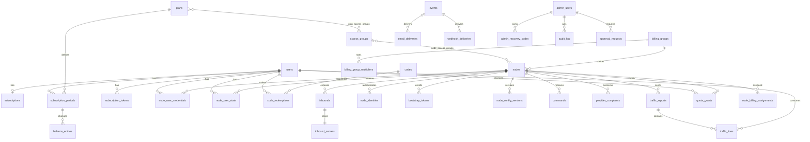

# 4. Модель данных

> Part of [docs/ARCHITECTURE.md](../ARCHITECTURE.md).


### 4.1 Концептуальная модель

| Сущность | Что представляет | Ключевые связи |
| :--- | :--- | :--- |
| User | Учётная запись пользователя | 1:1 Subscription, 1:N NodeUserCredential, 1:N SubscriptionToken |
| AdminUser | Учётная запись административной роли | 1:N RecoveryCode, 1:N AuditLog |
| Plan | Тариф | M:N AccessGroup, 1:N Protocol, 1:N SubscriptionPeriod |
| AccessGroup | Группа доступа | M:N Plan, M:N Node |
| BillingGroup | Тарифицируемая группа с коэффициентом | 1:N Node |
| Node | VPN-сервер | 1:N Inbound, 1:N NodeIdentity, 1:N NodeConfigVersion, 1:N Command |
| Inbound | Пара «нода × профиль» с параметрами подключения | 1:1 InboundSecret |
| NodeUserState | Состояние пользователя на ноде, поток состава | N:1 Node, N:1 User |
| NodeUserCredential | Credentials пары «пользователь × нода» | N:1 Node, N:1 User |
| Subscription | Текущее состояние подписки пользователя | 1:N SubscriptionPeriod |
| SubscriptionPeriod | Период подписки с лимитом и расходом | N:1 Plan |
| Code | Redeem- или Promo-код | 1:N CodeRedemption |
| TrafficReport | Принятый отчёт ноды, ключ идемпотентности | 1:N TrafficLine |
| TrafficLine | Неизменяемый факт потребления за интервал отчёта | N:1 User, N:1 Node |
| TrafficDaily | Суточный агрегат | N:1 User, N:1 Node |
| QuotaGrant | Выданный ноде грант квоты пользователя | N:1 User, N:1 Node |
| Event | Событие уведомления | 1:N EmailDelivery, 1:N WebhookDelivery |
| Job | Задача очереди | — |
| AuditLog | Запись административного действия | — |
| ApprovalRequest | Запрос второго подтверждения операции (§5.11) | N:1 AdminUser |
| ProviderComplaint | Обращение хостинг-провайдера (§16.7) | N:1 Node |
| Order, Payment | Заглушки платёжного контура (О-2) | N:1 User |

### 4.2 Логическая модель

СУБД — PostgreSQL 18. Идентификаторы — `uuid` (v7, монотонные по времени), кроме журнальных
таблиц с `bigint identity`. Время — `timestamptz` в UTC (R-52). Байты — `bigint`. Коэффициенты —
целые тысячные (`int`, §4.9). Адреса — `inet`. Перечисления — `enum`-типы PostgreSQL.

Поля с суффиксом `_enc` хранятся зашифрованными на уровне приложения (§7.2); поля с суффиксом
`_hash` — хешем без возможности восстановления.

#### 4.2.1 Учётные записи

```text
users
  id                     uuid PK
  email                  citext UNIQUE            — нормализованный адрес (§16.8)
  email_verified_at      timestamptz NULL
  email_undeliverable_at timestamptz NULL         — адрес недоставляем (ОВ-13, В-37): письма
                                                     событий §4.17 и impersonation не
                                                     отправляются; verify и reset
                                                     отправляются, принятое реле такое письмо
                                                     снимает пометку; видна в карточке (001.50)
                                                     и в ответе /me (001.16); колонка — 001.51,
                                                     ставит и снимает 001.78 по ответу
                                                     приёмника и по webhook отказов и жалоб
                                                     провайдера, выбранного до 001.78 (жалоба
                                                     ставит пометку)
  password_hash          text                     — argon2id
  status                 user_status              — active | blocked | deleted; blocked ставит
                                                     блокировка в панели вместе с подпиской
                                                     suspended_admin (В-40, 001.50)
  language               text                     — код языка из набора файлов locales/
                                                     (R-51, 001.65)
  timezone               text                     — IANA (R-52)
  aup_version            text                     — принятая версия правил (§16.5)
  aup_accepted_at        timestamptz
  announce_consent       boolean                  — канал объявлений (§17.11)
  created_at, updated_at timestamptz
  deleted_at             timestamptz NULL         — стирание PII по UC-14; строка сохраняется:
                                                     status = deleted, email — уникальная
                                                     заглушка deleted+{id}@invalid (NOT NULL
                                                     UNIQUE), password_hash — непроверяемая
                                                     заглушка, timezone = UTC (001.17)

admin_users
  id                     uuid PK
  email                  citext UNIQUE
  password_hash          text
  role                   admin_role               — super_admin | admin | operator | support;
                                                     назначает Super Admin в разделе
                                                     /admin/admins (001.89, В-33); первого
                                                     Super Admin создаёт CLI (001.47)
  totp_secret_enc        bytea NULL
  totp_enabled_at        timestamptz NULL
  status                 admin_status             — active | blocked; блокировка отзывает
                                                     сессии — 001.47 (`AdminService.block`);
                                                     маршрут — 001.89
  language               text
  created_at             timestamptz

admin_recovery_codes
  id                     uuid PK
  admin_user_id          uuid FK admin_users
  code_hash              text
  used_at                timestamptz NULL
  INDEX (admin_user_id) WHERE used_at IS NULL

email_tokens
  id                     uuid PK
  user_id                uuid FK users
  kind                   email_token_kind         — verify | reset
  token_hash             text UNIQUE
  expires_at             timestamptz              — срок ОВ-25
  used_at                timestamptz NULL

auth_events                                        — партиционирование по суткам, 90 дней (§16.2)
  id                     bigint NOT NULL DEFAULT nextval('auth_events_id_seq')
  user_id                uuid NULL
  kind                   auth_event_kind          — register | login | logout | reset
  ts                     timestamptz
  source_ip              inet
  user_agent             text
  result                 text                     — success | denied
  PK (ts, id), INDEX (user_id, ts DESC)
```

Сессии пользователей и администраторов хранятся в Redis (§7.1), не в PostgreSQL.

#### 4.2.2 Каталог

```text
plans
  id                     uuid PK
  name                   text UNIQUE
  price_amount           numeric(12,2) NULL       — справочное (О-2)
  price_currency         char(3) NULL             — ISO 4217 в каждой записи (ОВ-19 закрыт,
                                                     В-30)
  duration_days          int CHECK (> 0)
  traffic_limit_bytes    bigint NULL              — NULL = Unlimited
  device_limit           int NULL
  status                 plan_status              — active | archived
  created_at, updated_at timestamptz

plan_protocols
  plan_id                uuid FK plans
  profile                inbound_profile          — vless_raw_vision | vless_xhttp | trojan_reality
  PK (plan_id, profile)

access_groups
  id                     uuid PK
  name                   text UNIQUE
  description            text

plan_access_groups
  plan_id                uuid FK plans
  access_group_id        uuid FK access_groups
  PK (plan_id, access_group_id)

billing_groups
  id                     uuid PK
  name                   text UNIQUE

billing_group_multipliers                          — история коэффициента группы (§4.9)
  id                     uuid PK
  billing_group_id       uuid FK billing_groups
  multiplier_milli       int CHECK (BETWEEN 0 AND 10000 AND % 100 = 0)
  valid_from             timestamptz
  valid_to               timestamptz NULL         — NULL = действует
  EXCLUDE USING gist (billing_group_id WITH =, tstzrange(valid_from, valid_to) WITH &&)

node_billing_assignments                           — история назначения ноды (§4.9)
  id                     uuid PK
  node_id                uuid FK nodes
  billing_group_id       uuid FK billing_groups
  multiplier_override_milli  int NULL CHECK (BETWEEN 0 AND 10000 AND % 100 = 0)
  valid_from             timestamptz
  valid_to               timestamptz NULL
  EXCLUDE USING gist (node_id WITH =, tstzrange(valid_from, valid_to) WITH &&)
```

Правило целостности R-18: `nodes.billing_group_id NOT NULL` — ровно одна тарифицируемая группа;
поле дублирует действующее назначение из `node_billing_assignments` и обновляется в одной
транзакции с ним.

Разрешение коэффициента для строки отчёта выполняется по `period_start` строки: назначение ноды,
действовавшее в этот момент, затем переопределение, затем коэффициент группы на тот же момент,
затем 1.0. Момент приёма отчёта на выбор не влияет (§5.9).

Смена группы или переопределения закрывает действующий интервал значением `valid_to = now()` и
открывает новый; период агрегации `traffic_hourly` для ноды закрывается принудительно тем же
моментом (§4.9) — ключом строки часа: группа и коэффициент входят в PK `traffic_hourly`, строки
отчёта с `period_start` после смены идут в новую строку часа, ранее записанная по новому
коэффициенту не пересчитывается; признака «час закрыт» в схеме нет, `close_hour` (001.77b) в базу
не пишет. Интервалы одной ноды покрывают время от ввода в эксплуатацию без пробелов.

#### 4.2.3 Парк нод

```text
nodes
  id                     uuid PK
  code                   text UNIQUE              — JP-Tokyo-01
  name                   text
  country                char(2)
  city                   text
  provider               text
  public_ipv4            inet
  public_ipv6            inet NULL
  fqdn                   text NULL
  status                 node_status              — pending | provisioning | active | degraded |
                                                     offline | maintenance | disabled | suspended;
                                                     suspended ставит администратор (обращение
                                                     провайдера, 001.69) или автоматика по
                                                     повторным удержаниям отчётов (001.30c, В-5)
  status_changed_at      timestamptz
  activated_at           timestamptz NULL         — первый переход в active после последнего
                                                     подтверждения (В-13, 001.30): при
                                                     NULL возврат из offline и снятие ручного
                                                     статуса (001.30b) ведут в provisioning;
                                                     обмен нового bootstrap-токена сбрасывает
                                                     в NULL
  update_failed_at       timestamptz NULL         — отметка неуспешного update_agent (В-15,
                                                     001.30): нода active → degraded; снимают
                                                     следующий успешный update_agent и
                                                     установка ручного статуса (001.30b); обмен
                                                     нового bootstrap-токена сбрасывает в NULL
  manual_cleared_at      timestamptz NULL         — момент снятия ручного статуса: окно
                                                     held_reports_suspend начинается не раньше
                                                     него (В-5; колонка и запись — 001.30c)
  last_heartbeat_at      timestamptz NULL
  missed_heartbeats      int                      — счётчик для Н-15
  agent_version          text NULL
  xray_version           text NULL
  billing_group_id       uuid FK billing_groups NOT NULL   — денормализация действующего назначения
  multiplier_milli       int NULL CHECK           — денормализация действующего переопределения
  resync_required        boolean                  — обязать агента взять полный снапшот (§5.2)
  resync_seq             bigint NULL              — users.seq ответа с users.full = true,
                                                     выданного при взведённом resync_required;
                                                     признак снимается, когда resync_seq не NULL
                                                     и applied_users_seq ≥ resync_seq; каждый
                                                     взвод сбрасывает колонку в NULL (миграция —
                                                     001.75)
  ok_heartbeats          int                      — подряд успешных интервалов, для Н-15 и §4.7
  bandwidth_mbps         int                      — порог аномалии (§5.9); 1…100 000 Мбит/с:
                                                     граница держит списание в bigint (001.34)
  max_conn_per_ip        int                      — Н-29
  new_conn_rate_per_ip   int CHECK (> 0)          — частота новых соединений с одного адреса
                                                     клиента на порты inbound, соединений в
                                                     секунду (R-28, AC-40, В-10; meter
                                                     nftables); значения по умолчанию нет —
                                                     поле обязательно; колонка и раздел agent
                                                     — 001.27; правило — 001.86
  desired_config_version int
  applied_config_version int
  desired_users_seq      bigint
  applied_users_seq      bigint
  applied_at             timestamptz NULL
  monthly_cost           numeric(12,2) NULL
  currency               char(3) NULL
  provider_account       text NULL
  cost_valid_from        date NULL
  cost_valid_to          date NULL
  traffic_included_bytes bigint NULL
  traffic_overage_cost   numeric(12,4) NULL
  legal_profile          jsonb                    — Р-10
  created_at             timestamptz
  decommissioned_at      timestamptz NULL         — вывод из эксплуатации (§4.6 «Удаление»,
                                                     UC-12 A2; 001.87, В-21)
  INDEX (status), INDEX (billing_group_id)

node_ip_history                                    — смена адреса ноды (PATCH, 001.87, В-21)
  id                     bigint identity PK
  node_id                uuid FK nodes
  public_ipv4            inet
  valid_from, valid_to   timestamptz

node_access_groups
  node_id                uuid FK nodes
  access_group_id        uuid FK access_groups
  PK (node_id, access_group_id), INDEX (access_group_id)

bootstrap_tokens
  id                     uuid PK
  node_id                uuid FK nodes
  token_hash             text UNIQUE
  expires_at             timestamptz              — Н-24
  used_at                timestamptz NULL
  created_by             uuid FK admin_users
  annulled_at            timestamptz NULL         — повторная выдача или отзыв identity (131),
                                                     установка ручного статуса ноды (001.30b)
  issue_seq              bigint IDENTITY          — порядок выдачи без часов: «последний токен» (131;
                                                    строки до миграции — порядком id)
  CHECK (used_at IS NULL OR annulled_at IS NULL)

node_identities
  id                     uuid PK
  node_id                uuid FK nodes
  cert_fingerprint       text UNIQUE              — SHA-256 клиентского сертификата
  cert_serial            text UNIQUE              — серийный номер листа, форма $ssl_client_serial
  token_hash             text
  generation             int
  issued_at              timestamptz
  expires_at             timestamptz              — срок листа (90 дней); у прежнего поколения
                                                     после ротации — конец окна перекрытия
                                                     Н-28: выпуск нового + 7 суток (В-16, 001.31)
  revoked_at             timestamptz NULL
  enrolled_from          inet                     — адрес источника обмена токена (UC-01 шаг 6)
  UNIQUE (node_id, generation)                    — поколение: max + 1 под блокировкой ноды
  INDEX (node_id) WHERE revoked_at IS NULL

inbounds
  id                     uuid PK
  node_id                uuid FK nodes
  profile                inbound_profile
  port                   int CHECK (BETWEEN 1 AND 65535)
  tag                    text
  enabled                boolean
  reality_public_key     text
  reality_short_ids      text[]                   — hex, чётная длина, ≤ 16 символов
  reality_target         text
  reality_server_names   text[]
  reality_min_client_ver text                     — 1.8.1 из settings (WI-36)
  reality_max_client_ver text NULL
  reality_xver           int                      — 0 на всех нодах (В-17): это версия PROXY
                                                     protocol к цели, сторонний сайт-цель её
                                                     не принимает; рандомизируются только
                                                     limitFallback* (001.27)
  reality_limit_fb_up    int                      — миграция 060; объект Xray limitFallback*
  reality_limit_fb_down  int                        (три поля) в int не помещается — значения
                                                     в params (001.27)
  client_fingerprint     text                     — из набора допустимых в settings; chrome (WI-36)
  client_spider_x        text
  trusted_x_forwarded_for inet[]                  — sockopt, для размещения за CDN (Д-14)
  params                 jsonb                    — поля профиля §4.4: flow, decryption, xhttp_*,
                                                     x_padding_*, uplink_http_method,
                                                     session_id_placement, session_id_key;
                                                     limit_fallback_upload и
                                                     limit_fallback_download — {after_bytes,
                                                     bytes_per_sec, burst_bytes_per_sec}
                                                     (001.27)
  error_state            text NULL                — недоступность цели (Н-30): такой inbound в
                                                     выдачу подписки не попадает, остальные
                                                     профили ноды выдаются (В-12, 001.44)
  error_since            timestamptz NULL
  UNIQUE (node_id, profile), UNIQUE (node_id, port)

inbound_secrets
  inbound_id             uuid PK FK inbounds
  private_key_enc        bytea                    — x25519, §7.2
  key_version            int
  rotated_at             timestamptz

node_config_versions
  node_id                uuid FK nodes
  config_version         int
  config_json            jsonb                    — полная конфигурация Xray без credentials
  checksum               text
  created_at             timestamptz
  PK (node_id, config_version)

node_user_credentials
  id                     uuid PK
  user_id                uuid FK users
  node_id                uuid FK nodes
  xray_email             text                     — устойчивый тег u{user_id} (§5.9)
  vless_uuid_enc         bytea
  trojan_password_enc    bytea
  version                int
  rotated_at             timestamptz
  UNIQUE (user_id, node_id), INDEX (node_id)

node_user_state                                    — поток состава, материализованный
  node_id                uuid FK nodes
  user_id                uuid FK users
  state                  user_node_state          — active | suspended_quota | suspended_admin |
                                                     expired | removed
  quota_grant_bytes      bigint NULL              — NULL — без ограничения гранта (Unlimited,
                                                     В-6, 001.36): строка пользователя
                                                     Unlimited несёт NULL и до первого гранта
  quota_issued_seq       bigint                   — issued_seq гранта строки: агент применяет
                                                     грант только с номером больше применённого
                                                     (001.36)
  blocked_ips            inet[]
  updated_seq            bigint                   — users_seq изменения
  updated_at             timestamptz
  PK (node_id, user_id), INDEX (node_id, updated_seq)

commands
  id                     uuid PK                  — command_id
  node_id                uuid FK nodes
  type                   command_type             — restart_xray | rotate_credentials |
                                                     collect_diagnostics | update_agent
  payload                jsonb
  issued_at              timestamptz
  expires_at             timestamptz
  status                 command_status           — issued | delivered | applied | failed | expired
  result                 jsonb NULL               — статус и ошибка (до 2 000 символов); у
                                                     collect_diagnostics — output: версии,
                                                     статус служб, хвост журнала агента без
                                                     адресов пользователей, не больше 64 КиБ
                                                     (В-18; 001.31, агент — 001.81)
  INDEX (node_id, status)

node_metrics                                       — партиционирование по суткам, 30 дней
  node_id                uuid FK nodes
  ts                     timestamptz
  cpu_pct, mem_pct, disk_pct   real
  net_rx_bytes, net_tx_bytes   bigint
  online_ips             int
  connections            int                      — по данным ОС (§4.7)
  время работы                                    — ноды и агента (uptime_s, agent_uptime_s,
                                                     §4.7 источника)
  счётчики агента                                 — накопительные с запуска агента:
                                                     buffer_dropped_reports, counter_decreases,
                                                     clock_offset_ms, сумма и число
                                                     disconnect_seconds, report_rejects по коду;
                                                     имена и типы колонок — миграция 001.30
  PK (node_id, ts)

node_country_availability                          — R-06, приоритет S
  node_id                uuid FK nodes
  country                char(2)
  available              boolean
  checked_at             timestamptz
  PK (node_id, country)

provider_complaints                                — обращения хостинг-провайдера (§16.7, В-45;
                                                     001.69), 12 месяцев; адресов источника и
                                                     назначения в таблице нет
  id                     uuid PK
  node_id                uuid FK nodes
  period_start           timestamptz              — интервал жалобы: оператору — пользователи
  period_end             timestamptz                с трафиком на ноде за него (идентификатор
                                                     и объём по часам из traffic_hourly);
                                                     выборка в таблице не хранится; провайдеру
                                                     — только факт приостановки и меры
  complaint_ref          text                     — ссылка на обращение провайдера
  received_at            timestamptz              — получение обращения (ответ — за 24 ч)
  created_by             uuid FK admin_users
  created_at             timestamptz
  INDEX (created_at)                               — удаление по сроку (функция 001.69 в
                                                     retention.purge)
```

Инкрементальная выдача потока состава: агент передаёт `users_seq`; Control Plane возвращает
строки `node_user_state` с `updated_seq > users_seq`. Полный снапшот — все строки ноды, кроме
`removed`; агент, применяя ответ с `users.full = true`, удаляет из inbound пользователей,
отсутствующих в нём; ответ на `full=1` с `users.full = false` (фильтрующий статус) удаления не
разрешает. Строки `removed` удаляются задачей уплотнения 001.29 после подтверждения агентом
(`applied_users_seq ≥ updated_seq`).

Выделение `updated_seq`: в той же транзакции, что и запись строки, выполняется
`UPDATE nodes SET desired_users_seq = desired_users_seq + 1 WHERE id = $1 RETURNING
desired_users_seq`. Блокировка строки `nodes` упорядочивает коммиты по ноде.

**Why.** Номер из последовательности выделяется до коммита ⇒ транзакция с меньшим номером
может закоммититься позже, агент продвинет курсор и не получит её строку. Потерянной строкой
может оказаться отзыв доступа.

Состав строк: строка `node_user_state` и запись `node_user_credentials` существуют только для
пар, у которых тариф пользователя разделяет с нодой хотя бы одну группу доступа (§11.3). При
изменении групп лишние строки переводятся в `removed`, а credentials отзываются.

Вентиль по статусу ноды (§4.6): `Pending` — запрос состояния отклоняется; `Provisioning` — только
поток структурной конфигурации; `Disabled` и `Suspended` — только строки, снимающие доступ;
остальные статусы — оба потока полностью. При выдаче отфильтрованного ответа курсор `users_seq`
продвигается до наибольшего `updated_seq` выборки, а ноде выставляется `resync_required`; при
выходе из фильтрующего статуса агент обязан взять полный снапшот, который восстанавливает
пропущенные строки.

Ротация identity (Н-28, В-16; запуск и операция — interfaces.md §5.2): новое поколение получает
`generation + 1`; у прежнего `expires_at` := выпуск нового + 7 суток; смена `state_generation`
продлевает окно неотозванных прежних поколений с открытым окном до момента смены + 7 суток
(`extend_overlap_windows` 001.31, вызов — в транзакции смены поколения, 001.67).

Внешний журнал отзывов (В-20): на каждый отзыв identity — «серийный номер листа, время», на
каждое аннулирование bootstrap-токена — «хеш токена, время»; объект пишет задача очереди,
поставленная в транзакции отзыва, в журнал вне базы и вне хоста — то же S3-хранилище, что и копии
(ОВ-A1). Восстановление из копии повторяет отзывы журнала до открытия агентского порта: отзыв,
сделанный после точки копии, восстановлением не отменяется (001.67). Окно потери ограничено:
строка уходит в хранилище задачей после фиксации (секунды); при отказе хоста до выгрузки строки и
без архива WAL, покрывающего отзыв, отзыв этого окна повторяет оператор по записи инцидента
(reliability.md §9.2).

#### 4.2.4 Подписки и коды

```text
subscriptions
  user_id                uuid PK FK users
  state                  subscription_state       — none | active | suspended_quota |
                                                     suspended_admin | expired;
                                                     suspended_admin ставит блокировка
                                                     пользователя вместе с users.status =
                                                     blocked (В-40, 001.50) и снимает только
                                                     администратор (В-24, ниже)
  current_period_id      uuid NULL FK subscription_periods
  device_limit           int NULL                 — снимок из тарифа
  state_changed_at       timestamptz
  state_reason           text NULL                — причина последнего перехода (`set_state`);
                                                     источник причины отзыва в карточке (R-38;
                                                     миграция — 001.50)
  first_connected_at     timestamptz NULL         — первое подключение: ставит транзакция
                                                     приёма отчёта, пишущая user_online_ips,
                                                     при пустой отметке; показатель времени до
                                                     первого подключения (R-12, В-28; колонка и
                                                     запись — 001.16, отступление от 001.07)

subscription_periods
  id                     uuid PK
  user_id                uuid FK users
  plan_id                uuid FK plans
  period_start           timestamptz
  period_end             timestamptz
  traffic_limit_bytes    bigint NULL
  used_billable_bytes    bigint                   — денормализация суммы balance_entries;
                                                     после удаления записей report и
                                                     late_report по сроку (90 дней, §4.5)
                                                     остаётся итогом периода
  notified_80_at         timestamptz NULL         — 80 и 95 % — один раз за период (В-7)
  notified_95_at         timestamptz NULL
  exhausted_at           timestamptz NULL         — момент последнего исчерпания:
                                                     перезаписывается при каждом переводе в
                                                     suspended_quota, начисление и смена тарифа
                                                     его не очищают; входит в dedup_key события
                                                     traffic_exhausted — уведомление 100 %
                                                     повторяется при каждом новом исчерпании
                                                     (В-7, 001.35, 001.51)
  source                 period_source            — redeem | admin | order
  source_id              uuid NULL
  created_at             timestamptz
  INDEX (user_id, period_end DESC), INDEX (period_end)   — предикат с now() недопустим (не IMMUTABLE)

balance_entries                                    — журнал изменений баланса периода (R-21, R-38);
                                                     report и late_report — 90 дней, adjustment
                                                     и bonus — 24 месяца (§4.5, В-3)
  id                     bigint identity PK
  period_id              uuid FK subscription_periods — период по правилу ниже (В-1)
  source                 balance_source           — report | adjustment | bonus | late_report
  delta_billable_bytes   bigint                   — начисление — отрицательная дельта (001.22);
                                                     adjustment — в обе стороны: уменьшение
                                                     остатка — 001.50 (В-4)
  ref_key                text                     — ключ отчёта, id кода или id корректировки
  actor_id               uuid NULL
  reason                 text NULL                — обязательно для adjustment
  created_at             timestamptz
  INDEX (period_id, created_at)

subscription_tokens
  id                     uuid PK
  user_id                uuid FK users
  token_hash             text UNIQUE              — поиск по токену
  token_enc              bytea                    — значение для показа: кабинет, Support (с
                                                     записью в Audit Log), письмо активации;
                                                     FieldCipher, как codes.code_enc: версия
                                                     ключа — в контейнере (§7.2; миграция —
                                                     001.42)
  issued_at              timestamptz
  revoked_at             timestamptz NULL
  UNIQUE (user_id) WHERE revoked_at IS NULL

subscription_access_log                            — партиционирование по суткам, 30 дней
  id                     bigint NOT NULL DEFAULT nextval('subscription_access_log_id_seq')
  user_id                uuid
  ts                     timestamptz
  domain                 text
  format                 text
  user_agent             text
  source_ip              inet
  country                char(2) NULL
  PK (ts, id), INDEX (user_id, ts DESC)

codes
  id                     uuid PK
  kind                   code_kind                — redeem | promo
  code_hash              text UNIQUE
  code_enc               bytea                    — для экспорта (§4.14)
  batch_id               uuid NULL
  plan_id                uuid NULL FK plans       — у redeem обязателен: без тарифа — 422 при
                                                     создании (В-22, 001.20)
  expires_at             timestamptz NULL
  max_uses               int
  max_uses_per_user      int
  uses_count             int
  traffic_bonus_bytes    bigint
  duration_bonus_days    int
  created_by             uuid FK admin_users
  created_at             timestamptz
  INDEX (batch_id)

code_redemptions
  id                     uuid PK
  code_id                uuid FK codes
  user_id                uuid FK users
  period_id              uuid FK subscription_periods
  redeemed_at            timestamptz
  INDEX (code_id, user_id)

orders                                             — заглушка, О-2
  id, user_id, plan_id, amount, currency, status, created_at

payments                                           — заглушка, О-2
  id, order_id, provider, provider_ref, amount, currency, status, created_at
```

Контрольная сумма кода (§16.8) — последний символ кода (`VPN-XXXX-XXXY`: взвешенная сумма по
модулю 32, 001.18); проверка выполняется до обращения к базе.

Период списания строки отчёта (В-1, 001.77c): запись `balance_entries` источника `report` или
`late_report` и прирост `used_billable_bytes` относятся к периоду пользователя, действовавшему в
момент `period_start` строки, — последнему по `created_at` периоду, у которого
`min(period_start, created_at)` не позже `period_start` строки. При досрочном продлении трафик до
момента продления остаётся в прежнем периоде, после — в новом (пример §4.11: 100 ГБ на 35 дней);
строка из промежутка после истечения относится к истёкшему периоду. Строка раньше первого периода
пользователя или при пустом `current_period_id`: факты (`traffic_lines`, `traffic_hourly`)
пишутся, `balance_entries` — нет, запись журнала ERROR. `limits.check` и пороги 80/95/100 %
оценивают только текущий период; окно статистики текущего периода в кабинете —
`[min(period_start, created_at), period_end)`: функция окна — 001.77c, кабинет её переиспользует
(001.16). Почасовая статистика кабинета относит час к окну, которое содержит `hour_start`: в час
продления остаток в кабинете может отличаться от баланса не больше чем на трафик одного часа
(001.16, В-1).

Погашение кода (001.20). Redeem-код (В-22): подписки нет (`none`) — активация тарифа кода; тот же
тариф — продление (новый период, §4.11); другой тариф — 409 `code_plan_mismatch` (смену тарифа
выполняет администратор, UC-06 A1). Бонус дней `duration_bonus_days` (В-23): у `active` и
`suspended_quota` — `period_end` текущего периода + N дней на месте, лимит и
`used_billable_bytes` не меняются; Promo-код у `expired` и `none` — 409 `no_active_subscription`;
Redeem-код, в том числе у `expired` и `none`, погашается по правилу В-22 выше, и бонус продлевает
на N дней период, открытый этим погашением (правило Redeem-кода — `docs/reviews/wi-35-spec-review.md`
§5). При `suspended_admin` любое
погашение — 409 `subscription_blocked`; продление администратором и истечение `suspended_admin`
сохраняют (В-24; отступление от принятой 001.22: продление — 001.20, истечение — 001.83). В
режиме регистрации `invite` код приглашения — действующий Redeem-код: регистрация только с ним,
код сразу активирует подписку (В-31, 001.20); отдельного вида кода нет.

#### 4.2.5 Учёт трафика

```text
traffic_reports
  node_id                uuid FK nodes
  counter_epoch          uuid
  report_seq             bigint
  parts_total            int                      — объявленное нодой число частей интервала
                                                     (контракт 001.33; колонка — миграция 140)
  period_start           timestamptz
  period_end             timestamptz
  received_at            timestamptz
  status                 report_status            — accepted | held_anomaly | rejected_time |
                                                     interval_closed (последнее — часть к
                                                     закрытому интервалу, §5.2; значение
                                                     добавляет миграция 140); значение
                                                     duplicate есть в перечислении, но не
                                                     записывается: повтор отвечает по строке
                                                     ключа
  node_rx_bytes          bigint                   — счётчики интерфейса (второй источник)
  node_tx_bytes          bigint
  PK (node_id, counter_epoch, report_seq)          — CHECK report_seq ≥ 1: нумерация с единицы
  INDEX (node_id, received_at)                     — удержания ноды за окно
                                                     held_reports_suspend (001.30c, В-5)

report_intervals                                   — состояние интервала отчёта: правила частей
                                                     §5.2 требуют помнить его между частями
                                                     (миграция 140, 001.34)
  node_id                uuid FK nodes
  counter_epoch          uuid
  period_start           timestamptz
  period_end             timestamptz
  first_seq              bigint                   — report_seq первой принятой части
  parts_total            int                      — последнее принятое объявленное число частей
  parts_accepted         int                      — принятых частей (счётчик, не пересчёт)
  accepted_uplink_bytes  bigint                   — нарастающие суммы raw по направлениям
  accepted_downlink_bytes bigint                     принятых частей и списанной в пределах
                                                     потолка канала доли удержанных — к их
                                                     сумме порог §5.9 (полоса × длительность:
                                                     байт проходит порт дважды, 001.34)
  held                   boolean                  — в интервале удержанная часть (held_anomaly):
                                                     первая часть нового интервала открывает
                                                     его с held, удержанное продолжение ставит
                                                     held на существующей строке (второй строки
                                                     с тем же ключом нет), удержание по потолку
                                                     открытых создаёт строку закрытой (capped,
                                                     без списания); предыдущий интервал не
                                                     закрывается
  first_received_at      timestamptz
  last_received_at       timestamptz              — от него скользящий срок закрытия; потолок
                                                     возраста (48 ч, REPORT_MAX_INTERVAL_AGE) —
                                                     от first_received_at
  closed_at              timestamptz NULL         — NULL — открыт
  close_reason           text NULL CHECK (close_reason IN ('completed', 'superseded',
                                                     'deadline', 'age', 'capped'))
  CHECK (close_reason IS DISTINCT FROM 'capped' OR (held AND accepted_uplink_bytes = 0
         AND accepted_downlink_bytes = 0))        — capped — удержан и без списания (001.34)
  PK (node_id, counter_epoch, period_start, period_end)
  INDEX (node_id, period_end DESC)                 — последний принятый интервал ноды:
                                                     монотонность и якорь первого (§5.2)
  INDEX (node_id, first_received_at)               — смены эпохи за скользящие сутки, потолок
                                                     возраста открытых
  INDEX (node_id) WHERE closed_at IS NULL          — открытые интервалы ноды (потолок и закрытие)
  EXCLUDE USING gist (node_id WITH =, tstzrange(period_start, period_end) WITH &&)
                                                   — интервалы ноды не перекрываются (§4.4)

traffic_lines                                      — факт, партиционирование по суткам, 14 дней
  node_id                uuid
  counter_epoch          uuid
  report_seq             bigint
  user_id                uuid
  period_start           timestamptz
  period_end             timestamptz
  raw_uplink_bytes       bigint
  raw_downlink_bytes     bigint
  billable_bytes         bigint                   — floor(raw × multiplier)
  multiplier_milli       int                      — применённый коэффициент
  billing_group_id       uuid
  PK (period_start, node_id, counter_epoch, report_seq, user_id)
  UNIQUE (period_start, node_id, counter_epoch, period_end, user_id)
                                                   — пользователь в одной части интервала:
                                                     страховка правила приёма (001.34)
  INDEX (user_id, period_start), INDEX (node_id, period_start)

traffic_hourly                                     — час, партиции по суткам, 90 дней;
                                                     удержанная (held_anomaly) часть входит
                                                     долей в пределах порога (charged: raw доли
                                                     по направлениям и её billable), capped — не
                                                     входит; полный присланный raw — только в
                                                     traffic_lines, 14 дней (В-2, 001.77b)
  user_id                uuid
  node_id                uuid
  hour_start             timestamptz
  raw_uplink_bytes, raw_downlink_bytes, billable_bytes   bigint
  multiplier_milli       int
  billing_group_id       uuid
  PK (hour_start, user_id, node_id, billing_group_id, multiplier_milli)
  INDEX (user_id, hour_start), INDEX (node_id, hour_start)

traffic_daily                                      — 24 месяца
  user_id                uuid
  node_id                uuid
  day                    date
  raw_uplink_bytes, raw_downlink_bytes, billable_bytes   bigint
  PK (user_id, node_id, day), INDEX (node_id, day)

node_interface_hourly                              — второй источник, 90 дней
  node_id                uuid
  hour_start             timestamptz
  rx_bytes, tx_bytes     bigint
  PK (node_id, hour_start)

traffic_gaps                                       — партиции по суткам gap_start, 90 дней
  gap_start              timestamptz
  node_id                uuid                     — без FK: внешних ключей на партициях нет
                                                     (§4.3); 080 создаёт с FK — снять при
                                                     пересоздании (001.37)
  reason                 text                     — разрывы пишет сверка непрерывности
                                                     (001.37d); причина decommissioned при
                                                     выводе ноды — по ответу на вопрос «решить
                                                     здесь» 001.87
  gap_end                timestamptz
  estimated_bytes        bigint NULL
  PK (gap_start, node_id, reason)                  — ключ партиционирования в PK (иначе
                                                     PostgreSQL таблицу не создаст); тот же
                                                     ключ — идемпотентность: повторный проход
                                                     сверки непрерывности (001.37d) не дублирует
                                                     разрыв; приём 001.34 и закрытие интервалов
                                                     молчащих нод 001.37b разрывов не пишут —
                                                     только close_reason интервала; 080 создаёт
                                                     таблицу без партиций и с id — пересоздание
                                                     в миграции 001.37

reconciliation_runs                                — партиции по суткам created_at, 90 дней
  created_at             timestamptz
  id                     uuid
  kind                   reconciliation_kind      — arithmetic | cross_source | continuity
  scope                  jsonb                    — день, нода
  expected, actual       bigint
  delta_pct              numeric(6,3)
  status                 text
  PK (created_at, id)                              — ключ партиционирования в PK (001.37)

quota_grants
  id                     uuid PK
  user_id                uuid FK users
  node_id                uuid FK nodes
  period_id              uuid FK subscription_periods
  grant_bytes            bigint NULL              — NULL — грант Unlimited без ограничения: в
                                                     сумму непогашенных (AC-09) не входит (В-6,
                                                     001.36); CHECK (grant_bytes >= 0)
  consumed_bytes         bigint                   — подтверждено отчётами
  issued_at              timestamptz
  issued_seq             bigint
  superseded_at          timestamptz NULL         — выдан следующий грант
  INDEX (user_id, node_id, issued_at DESC), INDEX (period_id)

user_online_ips                                    — окно лимита адресов; адреса удержанных
                                                     (held_anomaly) и capped частей сюда не
                                                     пишутся
  user_id                uuid
  node_id                uuid
  ip                     inet
  last_seen              timestamptz
  PK (user_id, node_id, ip), INDEX (user_id, last_seen DESC)

held_online_ips                                    — адреса удержанных и capped частей: отчёт
                                                     сохраняется целиком, но в окно лимита
                                                     адресов не входит (001.77); 90 дней, как
                                                     traffic_reports (§16.2, В-49); адреса —
                                                     персональные данные (§16.1), удаляются и
                                                     при удалении аккаунта
  node_id                uuid
  counter_epoch          uuid
  report_seq             bigint                   — часть отчёта (ключ traffic_reports)
  user_id                uuid
  ip                     inet
  seen_at                timestamptz
  PK (node_id, counter_epoch, report_seq, user_id, ip)

user_blocked_ips
  user_id                uuid
  ip                     inet
  blocked_since          timestamptz
  PK (user_id, ip)
```

Строка отчёта относится к часу по `period_start`. `traffic_hourly` наполняется при приёме отчёта
в той же транзакции; поздний отчёт (UC-04 A7) добавляет к строке своего часа и порождает запись
`balance_entries` с источником `late_report` в период по правилу §4.2.4 (В-1). Поздний — отчёт,
у которого сутки `period_start` (UTC) раньше суток приёма (агрегат `traffic_daily` — по суткам
UTC; предикат — одна функция ядра 001.77 с модульным тестом, 001.77b и 001.77c её вызывают); он
ставит задачу `traffic.aggregate_day` своих суток с ключом `aggregate:{day}` (§5.4).

Трассируемость списания (R-21): в пределах 14 суток — до отчёта по ключу через `traffic_lines`.
Позже, до 90 суток, — до часа и ноды через `traffic_hourly`, до отчёта через `traffic_reports` и
до записи баланса через `balance_entries` источников `report` и `late_report`; после 90 суток —
до суток и ноды через `traffic_daily` (В-3). Начисления и корректировки (`bonus`, `adjustment`)
прослеживаются 24 месяца. У часа с удержанной частью Σ raw `traffic_lines` больше raw
`traffic_hourly` на удержанное превышение и объём частей `capped` (В-2): полный присланный объём
виден 14 суток.
Окно 14 суток покрывает разбор обращений поддержки (§17.5) и сверки §5.9.

Сверки `reconciliation_runs` (001.37d; пересоздание таблицы с партициями — миграция 001.37):

- `arithmetic` — обе стороны по ключу отчёта: `expected` — Σ `traffic_lines.billable_bytes` за
  сутки `period_start` по строкам, у которых есть период подписки; `actual` — Σ
  `balance_entries.delta_billable_bytes` источников `report` и `late_report`, чей `ref_key`
  ссылается на отчёты с `period_start` в тех же сутках; `adjustment` и `bonus` не учитываются;
  сверка суток D повторяется до D+3 (окно приёма 72 ч);
- `cross_source` — `expected` = (rx + tx) / 2 по `node_interface_hourly` ноды за сутки (байт
  пользователя проходит порт дважды); `actual` = Σ (`raw_uplink_bytes` + `raw_downlink_bytes`)
  `traffic_hourly` ноды за сутки; алерт, если (expected − actual) / expected вне коридора
  `settings.cross_source_tolerance_pct`, по умолчанию 15 % (решение ОВ-24).

#### 4.2.6 Уведомления, задачи, аудит, настройки

```text
events
  id                     uuid PK
  type                   event_type               — 12 типов §4.17
  user_id                uuid NULL
  node_id                uuid NULL
  payload                jsonb
  dedup_key              text UNIQUE              — подавление повторов; формула ключа по
                                                     типу события — 001.51
  created_at             timestamptz

email_deliveries
  id                     uuid PK
  event_id               uuid NULL FK events      — NULL у служебных писем (001.78)
  kind                   email_delivery_kind      — verify | reset | impersonation |
                                                     admin_2fa_reset | event; impersonation —
                                                     пользователю о начале работы поддержки от
                                                     его лица (001.48), admin_2fa_reset — каждому
                                                     активному администратору о сбросе второго
                                                     фактора (001.47, 001.89);
                                                     CHECK ((event_id IS NOT NULL) =
                                                     (kind = 'event')); доля доставленных
                                                     писем подтверждения (§17.7) — по
                                                     kind = 'verify' (001.78)
  email_token_id         uuid NULL                — ссылка служебного письма; без FK:
                                                     email_tokens живут 7 дней, доставки —
                                                     90 (§4.5)
  recipient              citext
  language               text
  status                 delivery_status          — pending | sent | bounced | failed;
                                                     bounced ставит
                                                     users.email_undeliverable_at (В-37, 001.78)
  attempts               int
  last_error             text NULL
  sent_at                timestamptz NULL

webhook_deliveries
  id                     uuid PK
  event_id               uuid FK events
  url                    text
  status                 delivery_status
  attempts               int
  next_attempt_at        timestamptz NULL
  response_code          int NULL

jobs
  id                     bigint identity PK
  queue                  job_queue                — critical | background
  type                   text
  payload                jsonb
  idempotency_key        text                     — частичная уникальность, см. §4.4
  run_at                 timestamptz
  attempts               int
  max_attempts           int
  locked_at              timestamptz NULL
  locked_by              text NULL
  status                 job_status               — pending | running | done | failed | dead
  last_error             text NULL
  created_at             timestamptz
  claimed_at             timestamptz NULL         — последняя выборка; остаётся после завершения (ожидание выбранной = claimed_at − run_at, готовой невыбранной = now() − run_at)
  finished_at            timestamptz NULL         — done | failed | dead
  INDEX (queue, status, run_at) WHERE status = 'pending'
  INDEX (claimed_at) WHERE claimed_at IS NOT NULL — окно метрики ожидания
  UNIQUE (idempotency_key) WHERE status IN ('pending', 'running')

audit_log                                          — append-only (§7.2)
  id                     bigint identity PK
  ts                     timestamptz
  actor_type             actor_type               — admin | user | system
  actor_id               uuid NULL
  actor_role             text NULL
  session_id             text NULL
  impersonated_user_id   uuid NULL                — работа от лица пользователя (§5.11, В-36):
                                                     просмотр расширенной карточки с данными
                                                     /me без входа в кабинет (001.48)
  user_agent             text NULL
  action                 text
  entity_type            text
  entity_id              text
  old_value              jsonb NULL
  new_value              jsonb NULL
  ip                     inet NULL
  result                 text                     — success | denied | error (§4.16)
  INDEX (ts), INDEX (entity_type, entity_id), INDEX (actor_id, ts)

approval_requests                                  — второе подтверждение (§5.11, ОВ-17, В-34;
                                                     001.48)
  id                     uuid PK
  operation              text                     — traffic | renew
  user_id                uuid FK users
  payload                jsonb                    — объём или срок, причина
  requested_by           uuid FK admin_users
  approved_by            uuid NULL FK admin_users — другая активная учётная запись; та же —
                                                     409 approval_same_account (001.48)
  status                 text                     — pending | approved | expired
  created_at             timestamptz
  expires_at             timestamptz              — created_at + 24 ч
  decided_at             timestamptz NULL
  INDEX (status, expires_at)

settings
  key                    text PK                  — перечень ключей — таблица ниже
  value                  jsonb
  updated_at             timestamptz
```

Ключи `settings`. Строку ключа создаёт миграция-сид задачи-владельца (`ON CONFLICT DO NOTHING`:
значение, изменённое панелью, миграция не перезаписывает). «Панель» — схема
`PATCH /admin/settings` (001.49; проверки и журнал по ключу — 001.85); ключ вне неё меняется
только миграцией.

| Ключ | Значение | Владелец | Кто меняет |
| :--- | :--- | :--- | :--- |
| `state_generation` | целое ≥ 0, поколение состояния для агентов (§5.2) | 001.09 (миграция 090) | C-01 при старте после восстановления (reliability.md §9.2) |
| `registration_mode` | `open` \| `invite` \| `closed`; по умолчанию `open`; `invite` — регистрация только с действующим Redeem-кодом (В-31, 001.20) | 001.14 (миграция 100) | панель |
| `disposable_email_domains` | список доменов одноразовой почты | 001.14 (миграция 100) | миграция |
| `captcha` | объект `{enabled}`; провайдер — ОВ-A3 | 001.14 (миграция 100) | панель |
| `email_token_ttl_minutes` | целое число минут, по умолчанию 15 (ОВ-25) | 001.14 (миграция 120) | миграция |
| `smtp` | параметры SMTP-реле и приёма webhook отказов и жалоб выбранного провайдера (ОВ-13, В-37: провайдер выбирается до 001.78, webhook реализует 001.78) | 001.78 (миграция-сид) | панель |
| `rate_limits` | в MVP ключа нет: пороги частоты §5.12 — константы `app/security/ratelimit.py` (001.14, 001.72, 001.84); строку ключа миграции не создают | — | — |
| `approval.traffic_bytes` | порог второго подтверждения начисления трафика, байт; по умолчанию `null` — выключен (ОВ-17, В-34) | 001.48 | панель (включение — в Audit Log) |
| `approval.renew_days` | порог второго подтверждения продления, дней; по умолчанию `null` — выключен (ОВ-17, В-34) | 001.48 | панель (включение — в Audit Log) |
| `webhooks` | список получателей | 001.79 (миграция-сид) | миграция |
| `aup` | версия и ссылка на текст правил `{version, url}` (§16.5) | 001.69 | миграция |
| `privacy_policy` | версия и ссылка на политику конфиденциальности `{version, url}` (тексты — от заказчика до 001.69, В-45) | 001.69 | миграция |
| `announcement` | `{key_fingerprint, text, signature}` — отпечаток ключа подписи и действующее объявление о смене домена, подписанное вне хоста (ОВ-15, В-44) | 001.70 | команда хоста `announce` (001.70) |
| `device_window` | длина окна подсчёта адресов, целое число минут; по умолчанию 60 — 1 ч (ОВ-23, В-8) | 001.38 | миграция |
| `held_reports_suspend` | `{count, window_hours}` — повторные удержания, переводящие ноду в `suspended`; по умолчанию `{3, 24}`; счёт — различные интервалы отчёта ноды (`counter_epoch`, `period_start`, `period_end`) хотя бы с одной частью `traffic_reports` со статусом `held_anomaly`, в том числе интервал с `close_reason = 'capped'` (`capped` — причина закрытия интервала, а не статус части), по `received_at` в скользящем окне, начало окна — не раньше `nodes.manual_cleared_at`; части одного интервала — одно удержание (В-5) | 001.30c | миграция |
| `profile_update_interval_hours` | значение заголовка `profile-update-interval`, ч; по умолчанию 1 (ОВ-18 закрыт, В-26) | 001.42 | миграция |
| `subscription_expiring_notice_days` | за сколько дней до `period_end` уведомление «Подписка истекает»; по умолчанию 3 (В-29) | 001.83 | миграция |
| `cross_source_tolerance_pct` | коридор межисточниковой сверки, %; по умолчанию 15 (ОВ-24) | 001.37d | миграция |
| `report_buffer_threshold_hours` | порог возраста `period_end` последнего принятого интервала ноды, ч; по умолчанию 20 — раньше исчерпания буфера Н-8 | 001.52 (событие `node_report_buffer_full`); тот же порог — правило алерта 001.68 | миграция |

Значения, которые задачи читают «из `settings`» без имени ключа: соответствие
`User-Agent → формат` (001.42), ссылки на клиенты (001.16), `min_client_ver` и набор допустимых
отпечатков `client_fingerprint` (001.27; набор меняет только миграция пересмотра §17.3, WI-36),
версии Xray-core и sing-box (001.31; в панели — «версии»). Имя ключа и форму значения задаёт
задача-владелец в своей миграции-сиде.

Домены подписки — не ключ `settings`: их задаёт окружение развёртывания `SUBSCRIPTION_DOMAINS`
(deployment.md, 001.15), панель показывает их только для чтения (`GET /admin/settings`, 001.49);
проверка «не меньше двух при `APP_ENV=prod`» — валидатор настроек окружения (001.45); замена
домена — процедура развёртывания: DNS, сертификаты, server nginx (В-27).

Ключа стратегии разрыва нет: `disconnect_strategy` раздела `agent` — константа модуля 001.40 со
значением, выбранным PoC-1а (001.88); невыбранные стратегии не реализуются, `restart_inbound` не
выбирается (ОВ-22; В-9, В-11).

Окна обслуживания в `settings` нет: это `silence` в Alertmanager по алертам приоритета
«Отложенный» (reliability.md §9.3, 001.68). Пункт панели «обслуживание» (idea §4.15) создаёт и
снимает `silence` через API Alertmanager, действие — в Audit Log (001.85, В-50).

### 4.3 Диаграмма сущностей

Диаграмма показывает ядро модели. Опущены журнальные и служебные таблицы: `traffic_daily`,
`node_metrics`, `subscription_access_log`, `auth_events`, `jobs`, `settings`, `user_online_ips`,
`held_online_ips`, `user_blocked_ips`, `traffic_gaps`, `reconciliation_runs`, `report_intervals`
(состояние интервала отчёта — служебная таблица приёма при `traffic_reports`), `node_ip_history`,
`node_country_availability`, `orders`, `payments`. Их связи — по идентификаторам, без внешних
ключей на партициях.



### 4.4 Правила целостности и индексы

| Правило | Реализация |
| :--- | :--- |
| Ровно одна тарифицируемая группа на ноду (R-18) | `nodes.billing_group_id NOT NULL` |
| Коэффициент 0.0–10.0 с шагом 0.1 (R-23) | `CHECK` на `multiplier_milli` в двух таблицах |
| Один профиль и один порт на ноду (R-03) | `UNIQUE (node_id, profile)`, `UNIQUE (node_id, port)` |
| Идемпотентность отчётов (R-21) | PK `(node_id, counter_epoch, report_seq)` |
| Одна активная ссылка подписки (R-14) | частичный `UNIQUE (user_id) WHERE revoked_at IS NULL` |
| Один credential на пару «пользователь × нода» (R-19) | `UNIQUE (user_id, node_id)` |
| Неизменяемость `billable_bytes` (R-23) | `traffic_lines` без `UPDATE` у роли приложения |
| Append-only Audit Log (R-37) | `REVOKE UPDATE, DELETE` у роли приложения; триггер `RAISE` |
| Один активный период на пользователя | `subscriptions.current_period_id` + проверка в домене |
| Датированность коэффициента (B-1) | интервалы `billing_group_multipliers` и `node_billing_assignments` без пересечений (`EXCLUDE`) |
| Интервалы отчётов ноды не перекрываются (§5.2, §5.9) | `EXCLUDE USING gist` по `(node_id, tstzrange(period_start, period_end))` на `report_intervals`; монотонность и якорь первого интервала — в домене (001.34) |
| Порядок изменений потока состава (M-2) | `updated_seq` только через `UPDATE nodes ... RETURNING`; выделение из последовательности запрещено |
| Состав потока по группам доступа (§11.3) | строки `node_user_state` только для пересечения групп; проверка в домене и задача уплотнения |
| Расшифровка credentials по identity | `node_id` берётся из `node_identities` по отпечатку; параметр запроса не используется |
| Изменение баланса журналируется (M-4) | запись `balance_entries` в той же транзакции; `used_billable_bytes` — денормализация |
| Идемпотентность задач (R-46) | частичная уникальность `idempotency_key` по статусам `pending`, `running` |
| Redeem-код несёт тариф (В-22) | проверка в домене (валидатор `CodeSpec`: Redeem-код без `plan_id` — 422), 001.20 |
| Второе подтверждение — другой учётной записью (§5.11, В-34) | проверка в домене при подтверждении `approval_requests` (409 `approval_same_account`) и срок 24 ч по `expires_at` (001.48) |
| Накопление `traffic_hourly` | значения строки часа только увеличиваются; перезапись и уменьшение запрещены |
| Отсутствие PII вне `users` (B-3) | `old_value`, `new_value`, `ip` в `audit_log` не содержат адресов почты и паролей; ссылки — по `user_id`; у записей `actor_type = user` поля `ip` и `user_agent` не заполняются (001.48) |

Индексы для частых запросов:

| Запрос | Индекс |
| :--- | :--- |
| Дельта потока состава для ноды | `node_user_state (node_id, updated_seq)` |
| Выдача подписки: ноды по группам доступа | `node_access_groups (access_group_id)`, `nodes (status)` |
| Статистика пользователя за период | `traffic_hourly (user_id, hour_start)` (`traffic_lines` хранится 14 дней) |
| Сверка по ноде за сутки | межисточниковая — `traffic_hourly (node_id, hour_start)`, `node_interface_hourly` PK; арифметическая — `traffic_lines (node_id, period_start)` |
| Приём части отчёта: последний принятый интервал ноды и открытые интервалы | `report_intervals (node_id, period_end DESC)`, частичный `(node_id) WHERE closed_at IS NULL` |
| Приём части отчёта: смены эпохи ноды за скользящие сутки | `report_intervals (node_id, first_received_at)` |
| Истечение подписок | `subscription_periods (period_end)` — без предиката: `now()` в предикате индекса PostgreSQL не допускает |
| Выборка задач | `jobs (queue, status, run_at) WHERE status = 'pending'` |
| Обращения к подписке в карточке | `subscription_access_log (user_id, ts DESC)` |
| Аутентификация ноды по отпечатку | `node_identities (cert_fingerprint)` |

### 4.5 Партиционирование и сроки хранения

| Таблица | Партиция | Хранение | Основание |
| :--- | :--- | :--- | :--- |
| `traffic_lines` | по суткам | 14 дней | окно трассируемости §4.2.5 |
| `traffic_hourly` | по суткам | 90 дней | Н-21, Н-22 |
| `traffic_reports` | нет | 90 дней | дедупликация; не меньше глубины буфера Н-8 |
| `report_intervals` | нет | 90 дней после `closed_at`; открытый интервал молчащей ноды закрывается по сроку и возрасту (`close_reason` `deadline`, `age`) периодической задачей 001.37b не позже потолка возраста (48 ч от первой части, `REPORT_MAX_INTERVAL_AGE`) | вместе с `traffic_reports`; открытых у ноды — не больше `REPORT_MAX_OPEN_INTERVALS` (001.33) |
| `traffic_gaps`, `reconciliation_runs` | по суткам | 90 дней | темп роста разрывов задаёт нода (§11.3): срок обязателен; PK включает ключ партиционирования |
| `traffic_daily` | нет | 24 месяца | Н-21 |
| `auth_events` | по суткам | 90 дней | §16.2 |
| `jobs` со статусом `done` | нет | 7 дней | обслуживание индекса |
| `jobs` со статусами `failed`, `dead` | нет | 30 дней | разбор отказов; удаление — 001.37 |
| `events`, `email_deliveries`, `webhook_deliveries` | нет | 90 дней | разбор доставок; период тарифа может быть длиннее срока, поэтому однократность за период держат колонки `subscription_periods` `notified_80_at`, `notified_95_at`, а не наличие строки `events`; повтор 100 % — новое значение `exhausted_at` в ключе события при каждом исчерпании (001.35, 001.51; В-7) |
| `commands` завершённые | нет | 90 дней | разбор инцидентов |
| `quota_grants` с `superseded_at` | нет | 30 дней | разбор перерасхода |
| `user_online_ips` | нет | по `last_seen`, окно `device_window` (1 ч, В-8) | лимит адресов; удаление строк с `last_seen` старше окна `device_window` — `retention.purge` 001.37 |
| `held_online_ips` | нет | 90 дней | вместе с `traffic_reports` (§16.2, В-49): адреса удержанных и `capped` частей (001.77); удаление — 001.37 |
| `email_tokens`, `bootstrap_tokens` использованные или просроченные | нет | 7 дней | — |
| `balance_entries` источников `report`, `late_report` | нет | 90 дней по `created_at` (В-3) | записи на каждую часть отчёта; срок почасовых записей §16.2; дальше трассировка — до `traffic_daily`; удаление — `retention.purge` 001.37 |
| `balance_entries` источников `adjustment`, `bonus` | нет | 24 месяца | начисления и корректировки с актором и причиной (R-38); удаление — `retention.purge` 001.37 |
| `provider_complaints` | нет | 12 месяцев | обращения провайдера (§16.7, В-45), срок — как у `audit_log` (Н-23); удаление — функция 001.69 по образцу 001.37 и её вызов в `retention.purge` |
| `billing_group_multipliers`, `node_billing_assignments` | нет | бессрочно | аудит коэффициентов R-23; переживают любой поздний отчёт |
| `node_interface_hourly` | нет | 90 дней | §5.9 |
| `subscription_access_log` | по суткам | 30 дней | §16.2 |
| `node_metrics` | по суткам | 30 дней | §17.4 |
| `audit_log` | нет | 12 месяцев | Н-23 |

Партиции создаются планировщиком на семь суток вперёд; устаревшие отсоединяются и удаляются той же
задачей. Объём `traffic_lines` при О-3: до 1 000 × 10 × 1 440 строк в сутки в худшем случае;
фактический объём ограничен числом активных пар «пользователь × нода» в каждом интервале.

### 4.6 Миграции

- Инструмент: `yoyo-migrations`, файлы `.sql` с явным `rollback`.
- Правило expand/contract (§17.2): добавление колонки и обратно совместимый код в выпуске N;
  удаление старой колонки в выпуске N+1.
- Схема: все объекты Control Plane — в схеме `control_plane`, не в `public` (решение
  2026-09-08: в одном кластере могут соседствовать другие решения, общая `public` даёт
  конфликты имён). Схему создаёт bootstrap ролей, владелец — `app_owner`; роли приложения
  получают `search_path = control_plane`; расширения устанавливаются в неё же; каждая миграция
  начинается с `SET LOCAL ROLE app_owner; SET LOCAL search_path TO control_plane`.
- Роли базы:
  - `app_owner` — владелец всех объектов; приложением не используется;
  - `app_rw` — C-01…C-03, только DML; без `UPDATE`/`DELETE` на `audit_log`, `traffic_lines`,
    `balance_entries`; на `traffic_hourly` разрешён `UPDATE` для накопления, `DELETE` запрещён;
  - `app_migrate` — миграции, отдельное подключение при старте C-01 (§10.2);
  - `app_backup` — только чтение, для C-11;
  - `app_audit_purge` — без входа; единственный держатель `DELETE` на `audit_log` (и `SELECT`
    колонки `ts`), владелец функции удаления по сроку хранения `purge_audit_log()`; `app_owner` —
    член без наследования прав (`INHERIT FALSE, SET TRUE`), чтобы миграции могли создать функцию
    под этой ролью (решение 2026-09-09, задача 001.09: проверка по тексту стека вызовов или по
    настройке сессии подделывается любым, кто может выполнить оператор).
- Обслуживание партиций и сроков хранения (§4.5) выполняется функциями `SECURITY DEFINER`,
  принадлежащими `app_owner`; C-03 вызывает их под `app_rw`. Удаление по сроку — отсоединение
  партиции или вызов такой функции, а не `DELETE` от роли приложения.
- Триггер `audit_log` запрещает `UPDATE` и `DELETE` для всех ролей, кроме функции удаления по
  сроку хранения: пропускается только `DELETE` под `current_user = app_audit_purge`. Сверх
  триггера `UPDATE`, `DELETE`, `TRUNCATE` отозваны и у владельца `app_owner`; остаточный путь —
  явный `SET ROLE app_audit_purge` или `GRANT` владельцем самому себе, действия заметные и
  равносильные `DISABLE TRIGGER`: защиты от владельца базы внутри базы не существует.
- Перечисления расширяются `ALTER TYPE ... ADD VALUE`; значения не удаляются.
- Данных для миграции нет (Д-10); первая миграция создаёт схему целиком, начиная с расширений
  `btree_gist` (для `EXCLUDE` по `uuid`) и `citext` (для адресов почты).
